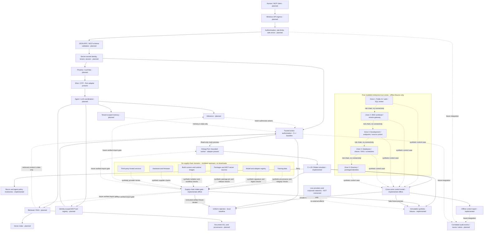

# Hostinger Simulator — Windows Native Core + Elixir/OTP

> **Status:** technical bootstrap / local-first simulator. This repository is an independent prototype. It is **not** a live infrastructure controller, not an official provider implementation, and not yet a complete MCP server.

## Objective

Build a deterministic, secure, testable infrastructure and collaboration simulator for Windows 10/11 and Windows Server (Windows 2022 C++ CI verified for prior versions; check current commit in Actions), with a C++ native engine compiled by CMake, an Elixir/OTP orchestration layer, and a future Phoenix/LiveView interface and MCP JSON-RPC adapter.

All operations are local mock previews. **No cloud accounts, DNS zones, virtual machines, mailboxes, or billing records are modified.** Real-provider integration is out of scope until explicitly authorized, designed, and separately tested.

## Technology baseline

- **Windows x64** development; Visual Studio 2022 C++ workload, CMake 3.24+, optional Ninja; PowerShell 7 recommended.
- **Native engine:** C++20 with RAII, strict input allowlists, bounded arguments, deterministic responses, thread-safe design principles, and explicit error handling.
- **Orchestration:** Elixir/Mix and Erlang/OTP; external executable isolated via Erlang Port. Native NIFs are not enabled by default.
- **UI (planned):** Phoenix + LiveView, not generated or installed in this bootstrap.
- **Protocol (planned):** Model Context Protocol over JSON-RPC 2.0 with tool discovery and validated tool invocations. The current CLI is *not* MCP wire-compatible.
- **Agent security bootstrap:** 14 synthetic threat-model cases; an executable fail-closed decision engine and guarded native preview call, with source trust, action scope, role, session boundary and explicit approval checks. There is no LLM, browser, database, credential store or network interception in this bootstrap.
- **Exposure assessment (synthetic):** 20 offline reconnaissance surfaces across model, retrieval, MCP tool discovery, gateway, orchestration and monitoring; role-gated reports with uniform denials and no network probes.
- **Cross-zone resilience model (synthetic):** 17 modeled multi-stage trust-boundary risks across public application, DMZ, gateway, development, database, file services, retrieval and identity. Every unsafe transition is denied as a local policy fixture; one read-only health preview provides a positive control.
- **AI component intake (synthetic):** 26 supply-chain risk fixtures spanning MCP server releases, dependency resolution, unsafe deserialization, model weights, datasets, adapters, tokenizers, build infrastructure, hardware and third parties. The fail-closed C++ policy evaluates *simulated* evidence. No real artifact is loaded, scanned, hashed or cryptographically verified.
- **Testing:** CTest + ExUnit; dependency scanning, fuzzing, static analysis, reproducibility tests and observability are delivery gates.

## Repository layout

```text
project/
  CMakeLists.txt               C++ build and test targets
  CMakePresets.json           Windows configuration presets
  include/simulator/          Native public interfaces
  src/native/                 Native simulator, policy engine and CLI
  tests/                      Native, policy, exposure, cross-zone and supply-chain tests
  elixir/                     Minimal Mix application with Port wrapper
  .github/workflows/          Windows build/test CI
```

The private reference library lives outside this Git repository at `../library/`; it is not committed or published.

## Quickstart — Windows PowerShell

Open **Developer PowerShell for Visual Studio 2022** in this directory:

```powershell
cmake --preset windows-msvc
cmake --build --preset windows-msvc --config Release
ctest --preset windows-msvc -C Release --output-on-failure
.\out\build\windows-msvc\Release\simulator.exe list
.\out\build\windows-msvc\Release\simulator.exe call websites.list demo
.\out\build\windows-msvc\Release\simulator.exe call monitoring.health demo
.\out\build\windows-msvc\Release\simulator.exe security list
.\out\build\windows-msvc\Release\simulator.exe recon list
.\out\build\windows-msvc\Release\simulator.exe recon inspect rag_source_attribution viewer
.\out\build\windows-msvc\Release\simulator.exe recon inspect rag_source_attribution reviewer
.\out\build\windows-msvc\Release\simulator.exe capstone list
.\out\build\windows-msvc\Release\simulator.exe supplychain list
.\out\build\windows-msvc\Release\simulator.exe supplychain report
.\out\build\windows-msvc\Release\simulator.exe supplychain simulate dependency_confusion reviewer
.\out\build\windows-msvc\Release\simulator.exe supplychain baseline reviewer
.\out\build\windows-msvc\Release\simulator.exe capstone report
.\out\build\windows-msvc\Release\simulator.exe capstone assess rag_file_boundary reviewer
.\out\build\windows-msvc\Release\simulator.exe capstone simulate rag_file_boundary retrieved_document reviewer same_session approved
.\out\build\windows-msvc\Release\simulator.exe capstone simulate safe_health_preview trusted_application operator same_session approved
.\out\build\windows-msvc\Release\simulator.exe security call web_page operator same_session approved vps.list demo
.\out\build\windows-msvc\Release\simulator.exe security call trusted_application operator same_session approved vps.list demo
```

Alternative Ninja workflow with an active compiler environment:

```powershell
cmake --preset windows-ninja
cmake --build --preset windows-ninja
ctest --preset windows-ninja --output-on-failure
.\out\build\windows-ninja\simulator.exe list
```

## Capability inventory — planned vs implemented

| Domain | Current local sample | Planned extension |
|---|---|---|
| Websites | `websites.list`, `websites.deploy_preview` | deployment status, preview fixtures |
| VPS | `vps.list`, `vps.power_state` | lifecycle, metrics, failure injection |
| Domains / DNS | `domains.list`, `dns.records` | zones, records, TTL validation |
| Mail | `mail.domains`, `mailboxes.list`, `mailboxes.create_preview` | mailbox quotas, aliases, protocol emulation |
| Collaboration | calendar, contacts, tasks preview | scheduling, delegation, synchronization |
| Subscriptions | `subscriptions.list` | synthetic billing schedules |
| Commerce | `ecommerce.store_preview` | simulated catalog and checkout status |
| Support | `support.ticket_preview` | tickets, priorities, response measurements |
| Backup | `backup.restore_preview` | recovery exercises and restore points |
| Monitoring | `monitoring.health` | availability, synthetic incidents and alerts |

These are **project-defined sample capabilities**. No claim is made that they match every feature of any upstream repository or provider. Exact compatibility requires an upstream source audit and contract tests.

## Engineering rules

- Treat inputs as untrusted. Enforce explicit tool allowlists, length limits, schema validation, least privilege and fail-closed errors.
- Native code must avoid unchecked buffer operations, ownership ambiguity, path traversal, use-after-free, integer overflow and unsynchronized shared state.
- Default to out-of-process native workers, supervised by OTP; move only narrowly scoped, measured operations to NIFs after ABI and failure analysis.
- Build in isolated directories, use locked dependencies when introduced, keep secrets outside source control, and inspect dependency licenses.
- Test happy paths, forbidden tools, hostile inputs, timeout/crash recovery, platform behavior, determinism and eventual MCP conformance.
- Keep production-style logs structured and redact secrets; separate incident simulation from genuine operational assertions.
- Availability and incident-response commitments are **synthetic test requirements**, never customer guarantees.

Architecture, service scenarios, the engineering technique matrix and delivery gates are documented below in this README.

## Architecture — Windows / native process integration

### Complete layered architecture and trust boundaries

The following is the **target architecture**, not an assertion that every service exists yet. Solid flow lines represent designed data paths. The compiled baseline is the local C++ simulator, native authorization gate, offline security-case inventory and offline cross-zone control model and supply-chain intake fixtures; all network ingress, real retrieval, inference, durable memory and interactive UI components remain planned.



**Trust zones:** the public ingress is untrusted; agent prompts, retrieved documents, web pages, model output, tool results and memory are **data-only**; authority comes from independently authenticated application context. Private tool schemas, backend versions, document names, embedding configuration and debug details require separate exposure controls. Rendered health and error responses must disclose no infrastructure topology. The native C++ CLI is a developer diagnostic, not an MCP or HTTP authorization endpoint. The supply-chain section depicts proposed intake paths, **not trusted links already implemented between registries and running components**.

**Implementation boundary:** `simulator security call` enforces the local native permission preview. `simulator recon inspect` separately exercises synthetic information-disclosure decisions. `simulator capstone simulate` evaluates offline risk-chain fixtures and never opens a session, network route or privilege. `simulator supplychain` checks metadata-only local fixtures, not actual signatures, SBOMs, hashes or models. Neither command accepts real credentials, sends requests or operates on live tenants. The current Elixir adapter does not yet enforce these gates end to end. A future network service MUST bind source, identity, role and approval server-side, not allow clients or models to select them.

### Boundaries and safety

1. No provider API credentials or network mutations.
2. Tool names are allowlisted; unknown operations fail closed.
3. Resource identifiers are limited to 256 ASCII bytes from an explicit safe-character set; native tool names are allowlisted.
4. Responses have explicit `simulation_only` and `side_effects:false` markers.
5. Scope every proposed action to an authenticated principal, tenant, session and approved tool capability outside the model context. A prompt, tool result, website, document, source comment or shared KB entry must never directly supply authorization.
6. Shared knowledge writes require reviewer workflow and immutable provenance; memory reads require session/tenant isolation. Session tokens must be cryptographically unpredictable and rotated/invalidated safely when the future session service is built.
7. OTP supervises any future long-lived worker. Use Ports first; NIF usage requires crash isolation strategy, ABI testing, scheduler-bound execution, and fuzzing.
8. Real MCP transport must implement JSON-RPC, initialization, `tools/list`, `tools/call`, version negotiation, lifecycle and protocol compliance tests before claiming support.
9. Future Phoenix integration requires authorization, CSRF/session defenses, rate-limiting and audit trails.

### Threat scenarios

- Input-induced crashes, memory faults, resource exhaustion and process hangs.
- Privilege confusion between mock and live environments.
- Unauthorized tool calls, spoofed sessions and leaked authorization context.
- Inconsistent fixture state and nondeterministic replay.
- Invalid deserialization and untrusted protocol messages.
- Accidental network effects, DNS changes or mail delivery from simulations.

### Local security policy demonstrations

These commands are deterministic **risk-control simulations**, not attack execution or a deployed agent. The `source` parameter is a trusted test fixture chosen by the local test runner. It is **not** a claim that an attacker-supplied string can determine the real origin of data.

```powershell
# Inventory modeled entry points, abuse cases and required defenses
.\out\build\windows-msvc\Release\simulator.exe security list
.\out\build\windows-msvc\Release\simulator.exe recon list
.\out\build\windows-msvc\Release\simulator.exe recon inspect rag_source_attribution viewer
.\out\build\windows-msvc\Release\simulator.exe recon inspect rag_source_attribution reviewer

# Untrusted page content cannot authorize a tool call: decision = deny
.\out\build\windows-msvc\Release\simulator.exe security call web_page operator same_session approved vps.list demo

# Trusted application context, explicit approval and matching scope: mock preview only
.\out\build\windows-msvc\Release\simulator.exe security call trusted_application operator same_session approved vps.list demo

# Crossing a session boundary is denied regardless of role
.\out\build\windows-msvc\Release\simulator.exe security evaluate trusted_application read_private_memory reviewer cross_session approved
```

Policy decisions always mark `simulation_only` and `side_effects:false`. Evaluation is performed in the C++ boundary and does not parse or execute the supplied untrusted text. A real implementation must derive source identity, permissions, approvals and session binding from authenticated server-side context, never from client-request fields.

### Implementation stages

- Gate A: deterministic C++ CLI, security decision tests, guarded mock dispatch, cross-zone risk fixtures and clean Windows build.
- Gate B: real Elixir Port integration with supervision and restart tests.
- Gate C: strictly local MCP JSON-RPC tool adapter and protocol conformance suite.
- Gate D: Phoenix LiveView admin console and scenario editor.
- Gate E: service scenarios, Zimbra collaboration fixtures, trace metrics and security gates.


## Agent abuse-case matrix — synthetic lab only

The following is the complete first-pass set of agent-specific abuse cases prioritized for controlled testing. They are not exploit recipes or claims of successful attacks. **Inventory status** means the case is modeled in `security list`; **policy gate** means at least one corresponding permission or data-flow denial is tested in C++. Input transformation detection, real agent behavior and cross-session persistence remain future integration work.

| Scenario | Untrusted entry / behavioral risk | Enforced or planned defense | Current gate |
|---|---|---|---|
| Agent surface inventory | Tool and endpoint discovery reveals effective capabilities | Server-side tool registry, contract review, least privilege | Inventory |
| Direct instruction override | User message conflicts with trusted workflow | Application-owned action policy, no privilege from conversation | Policy gate |
| System configuration disclosure | Request to expose internal instructions or credentials | Keep secrets out of prompts; deny secret disclosure at output boundary | Policy gate (synthetic) |
| Output-filter bypass | Formatting changes evade text matching | Data classification and sink authorization rather than keyword matching | Policy gate (synthetic); content inspection planned |
| Troubleshooting pretext | Operationally framed request seeks privileged data | Identity/role authorization checked on every action | Policy gate |
| Objective reframing | Harmless-looking task requests unauthorized result | Fixed workflow scopes and approval outside model context | Policy gate |
| Multi-turn escalation | Benign requests lead to unauthorized later action | Revalidate every tool call; maintain auditable state transitions | Policy gate; dialogue tests planned |
| Multi-document fragmentation | Separate documents combine to form a hostile instruction | Treat the entire batch as untrusted; aggregate-context testing | Policy gate; batch tests planned |
| Hidden web content | HTML/CSS carries instructions not visible to users | Render/extract only required data; prohibit data-origin authorization | Policy gate; HTML tests planned |
| Source-code Unicode tricks | Confusable/nonprinting characters manipulate code review | Unicode policy, safe rendering, import resolution integrity checks | Policy gate; parser tests planned |
| Tool response poisoning | External tool result attempts to direct another tool | Tool output never confers permissions; strict result schema | Policy gate; MCP integration planned |
| Shared knowledge poisoning | Malicious wiki entry persists and affects future sessions | Signed provenance, reviewed publication, tenant-scoped retrieval | Policy gate; persistence tests planned |
| Predictable session IDs | Session identifiers can be guessed or enumerated | Cryptographically random opaque session IDs, session expiration, rate limits | Inventory; session service planned |
| Cross-session memory access | One user accesses another user's private context | Tenant/principal/session binding on every read | Policy gate; session service planned |

### Attack simulation cycle and evidence

Use a bounded, isolated **inventory -> synthetic probe -> policy decision -> expected-vs-observed comparison -> regression** workflow. Record `scenario_id`, fixture hash, expected decision, actual decision, role, session scope, timestamp, test version and result. Avoid real credentials, external endpoints, arbitrary URL fetches and unapproved write effects. Measure false allowances and false denials separately; never interpret blocked keywords as evidence of secure authorization.

### Acceptance tests for this first stage

- Untrusted user, document, document batch, web, source-code, tool-output and memory contexts cannot authorize a protected native action.
- Unknown sources/actions fail closed; cross-session requests are denied.
- Secret disclosure and network egress are disabled even for privileged local role fixtures.
- Shared-memory writes need trusted application context, reviewer role and explicit approval, and still remain preview-only.
- Authorized calls remain constrained by the native tool allowlist, resource validation and `side_effects:false`.
- Compile and run the 22 CTest targets in supported builds. Windows execution must be confirmed by CI for this commit; Erlang Port/Elixir end-to-end evaluation remains pending.

**Scope limits:** No prompt-injection classifier, multi-agent orchestrator, real OAuth/RBAC implementation, real session storage, HTML parser, Unicode normalization engine, MCP wire adapter, Phoenix app, or production telemetry is included yet. The cases above define the requirements and the testable native authorization baseline, not a finished platform.


## AI exposure reconnaissance — offline assessment model

The inventory below models externally observable properties and leakage risks across the AI application stack. It is **not a scanner**, agent fingerprinting engine, RAG service, log collector or vulnerability claim. All entries are immutable synthetic records with no outbound requests, real credentials, collected model data or secret endpoints.

| Surface | Synthetic risk focus | Target control | Current status |
|---|---|---|---|
| UI and static assets | Client-side feature flags, internal API addresses and debug flags | Public asset review and restricted configuration | Offline fixture |
| Gateway and health | Backend version headers, verbose health/error metadata, endpoint existence and rate behavior | Minimal responses, consistent auth, throttling | Offline fixture |
| Orchestration and inference | Framework, provider, model and capability fingerprinting | Redacted errors, metadata minimization, query budgets | Offline fixture |
| Tool registry (MCP) | Overbroad `tools/list` visibility, schemas and permissions | Identity-scoped discovery, per-call authorization | Offline fixture |
| Agent federation | Capability and trust relationship disclosure | Authenticated delegation and scoped metadata | Offline fixture |
| Retrieval (RAG) | Document attribution leakage, chunk/embedding inference, source provenance | Tenant ACL, source-filtered citations, integrity reviews | Offline fixture |
| Detection and evidence | Keyword-only rules, cross-session correlation gaps, canaries | Behavioral analytics, trace correlation, canary integrity alerts | Offline fixture |

### Safe CLI demonstration

```powershell
# 20 mapped surfaces: all static synthetic descriptions
.\out\build\windows-msvc\Release\simulator.exe recon list

# Same opaque denial for unknown and restricted fixtures at viewer level
.\out\build\windows-msvc\Release\simulator.exe recon inspect rag_source_attribution viewer
.\out\build\windows-msvc\Release\simulator.exe recon inspect unlisted_fixture viewer

# Reviewer receives a synthetic risk/control summary, never actual data
.\out\build\windows-msvc\Release\simulator.exe recon inspect rag_source_attribution reviewer
```

The `role` argument is a developer-controlled test input **only**. A real API cannot permit the caller to self-assert reviewer identity. The same denial response for unknown and protected fixture IDs prevents an existence oracle; inventory descriptions deliberately contain no real service identifiers. Actual logs, honeypots, adaptive detection, rate limiting, model behavior tests and active network discovery are **future work**.

**Evaluation gates:** identical deny response for unknown and unauthorized IDs; no network egress; deterministic output; reviewer-only detailed synthetic summaries; tool discovery and retrieval metadata do not grant actions; telemetry correlation and source redaction must be integrated and tested before any live deployment. Do not use keyword-based monitoring as the only mechanism for preventing unauthorized access.

## Cross-zone risk-chain simulation — offline control model

The enterprise threat model describes **17 independently testable trust-boundary risks**, organized along five synthetic zones: public AI and database mediation, DMZ and remote gateway, development endpoints and source control, internal databases and retrieval, and privileged directory identities. **Every high-risk transition is a denied fixture**, even if a test role is marked as reviewer or the source is `trusted_application`. This is a safety specification for future integration, **not evidence of real-world detection or exploit prevention**.

| Boundary | Risk-class fixture | Required safeguard | Delivery status |
|---|---|---|---|
| Public AI to data | Model-generated privileged database operation | Read-only parameterized query service with explicit SQL operation allowlist | Synthetic deny |
| AI to tools | Model output treated as authority | Application-owned permission checks on every tool call | Synthetic deny |
| Public workload to DMZ | Inherited backend permissions or unrestricted service egress | Isolated workload identity, deny-by-default egress | Synthetic deny |
| DMZ to remote access | Inappropriate privileged group membership or broad gateway session | Approved membership changes, role-scoped remote session and audit | Synthetic deny |
| Developer endpoint | Local privilege or developer token exposure | Endpoint hardening, scoped tokens, protected credential store | Synthetic deny |
| Database to internal shares | Shared service credentials or unscoped file permissions | Unique service identities, per-principal shares and access auditing | Synthetic deny |
| Shared automation | Unsigned scripts, module path ambiguity, writable service artifacts | Immutable releases, verified module imports, protected install paths | Synthetic deny |
| Retrieval to filesystem | Hostile document controls agent behavior or unbounded file reads | Treat retrieval as data; canonical directory allowlist and independent approval | Synthetic deny |
| Process and directory identity | Secrets in process memory or multi-zone privilege chaining | Secret isolation, tiered administrative identities, least privilege | Synthetic deny |
| Monitoring across stages | Independent alerts not correlated into an incident | Stable trace/session identifiers, correlation rules and alert review | Synthetic deny; real telemetry planned |

### Local deterministic control demonstrations

```powershell
# Inventory the 17 modeled trust-boundary risks
.\out\build\windows-msvc\Release\simulator.exe capstone list

# View a reviewed synthetic control explanation; public roles receive uniform denial
.\out\build\windows-msvc\Release\simulator.exe capstone assess rag_file_boundary reviewer
.\out\build\windows-msvc\Release\simulator.exe capstone assess rag_file_boundary viewer

# An unsafe RAG-to-filesystem transition is blocked even with fixture approval
.\out\build\windows-msvc\Release\simulator.exe capstone simulate rag_file_boundary retrieved_document reviewer same_session approved

# The one positive fixture is an authorized, read-only, offline health preview
.\out\build\windows-msvc\Release\simulator.exe capstone simulate safe_health_preview trusted_application operator same_session approved

# Report modeled coverage; actual detection rate remains unknown
.\out\build\windows-msvc\Release\simulator.exe capstone report
```

**Controls and evidence:** C++ evaluates local fixture roles and sources, not authenticated identities. There are no connection tunnels, payloads, credentials, scans, Windows domain operations, SQL connections or modifications of live systems. Each response explicitly declares `simulation_only`, `network_access:false` and `side_effects:false`. The report exposes `real_attacks_executed:0` and `real_detection_rate:null`, so modeled policy coverage cannot be misrepresented as incident-prevention performance.

**Acceptance gates:** deny all 17 modeled unsafe paths; preserve indistinguishable denial for unknown/unauthorized identifiers; deny untrusted source, cross-session and missing-approval variations; allow only the synthetic positive health fixture; verify every returned record remains read-only; run 22 CTest cases in Debug, Release and Windows CI. Future real integration needs trusted server-issued identities, data-layer ACLs, runtime telemetry, RAG ingestion tests, and independently reviewed adversarial validation.

## AI/ML supply-chain integrity — offline synthetic controls

The intake model covers **26 negative cases** across six component families: training data, models, software (including MCP servers), infrastructure, hardware, and third-party services. Dataset/adapter/tokenizer concerns are tracked separately. No external dependency, model, Python pickle, package index, registry, repository or customer service is contacted or executed. The total inventory is **77 distinct synthetic risk cases** (14 agent + 20 exposure + 17 cross-zone + 26 supply chain), not 77 vulnerabilities discovered.

### Supply-chain control gates

| Asset boundary | Synthetic risk examples | Independent release gate | Implementation |
|---|---|---|---|
| MCP servers and plugins | changed tool descriptions, altered source releases, unknown publisher | signed release, approved registry, reviewed tool capabilities | offline policy fixtures |
| Package resolution | dependency confusion, mutable version, namespace similarity | exact registry, namespace, version and digest lock | offline policy fixtures |
| Serialized models | risky deserialization, external references, model namespace reuse | data-only format allowlist, isolate ingest, pin model identity and hash | offline policy fixtures |
| Model behavior | modified weights, scanner-only false confidence | integrity gate **plus** behavior regression checks | offline policy fixtures |
| Training data and adapters | changed samples, unapproved adapter deltas, changed tokenizer mappings | dataset lineage, signed snapshots, independent review | offline policy fixtures |
| CI and infrastructure | mutable actions, compromised runners, artifact drift | least-privilege checkout, immutable action SHA, isolated build and SBOM | CI permission/SHA hardening present; other checks planned |
| Hardware and hosted services | unverified firmware or service revision | verified supplier, approved inventory and change control | offline policy fixtures |

**Important evidence boundary:** `verify_fixture` validates whether *supplied synthetic metadata* satisfies an exact policy. Comparing SHA-256-looking strings is **not the same as hashing artifact bytes**; boolean fixture fields are **not signature verification, license scanning or human approval**. Those must eventually be derived by trusted server-side workflows and cryptographic tooling before any real artifact is admitted. Static scanners alone cannot establish model integrity or behavioral safety.

```powershell
# Enumerate 26 negative intake scenarios and the modeled failures
.\out\build\windows-msvc\Release\simulator.exe supplychain list
.\out\build\windows-msvc\Release\simulator.exe supplychain assess model_weight_tampering reviewer
.\out\build\windows-msvc\Release\simulator.exe supplychain simulate model_weight_tampering reviewer
.\out\build\windows-msvc\Release\simulator.exe supplychain simulate dependency_confusion reviewer

# Positive metadata-only test fixture; NOT a real trusted model
.\out\build\windows-msvc\Release\simulator.exe supplychain baseline reviewer
.\out\build\windows-msvc\Release\simulator.exe supplychain report
```

**Acceptance:** all 26 negative cases reject a mismatched gate; unrecognized assets and unauthorized roles receive uniform denial; a known-good *metadata fixture* passes; all responses remain local with `network_access:false` and `side_effects:false`; release CI passes 22 CTest targets. Real acceptance requires independently computed SHA-256, signature and provenance checks, license policy, generation of actual SBOM/AI-BOM, controlled registry resolution, file-format sandboxing, model behavior tests, reviewer identity and operational audit trails.

## Simulator service and collaboration scope

**All services below are hypothetical local fixtures; no production services are enabled.**

| Area | Planned mock workflow | Validation |
|---|---|---|
| Websites | list, preview deployment, status | no external deployment |
| VPS | list, start/stop preview, snapshot | no hypervisor access |
| Domains/DNS | list zones, preview records, TTL checks | no DNS mutation |
| Mail | domains, mailboxes, aliases, quotas, policies | no email transmission |
| Collaboration | calendar, contacts, tasks, documents, sharing | synthetic identity boundaries |
| Support | incident ticket, priority, triage, SLA clock | traceability and timestamps |
| Continuity | incremental/full backup fixture, restore preview | verify recovery scope |
| Security | roles, alerts, audit, antispam/antimalware events | test auth boundaries |
| Billing | subscription state and synthetic charges | no financial events |
| Ecommerce | catalog and checkout preview | no real payments |

### Historical service-model inspiration (not contractual promises)

The supplied examples distinguish **hosted** from **fully managed** administration, support windows of **8x5** with optional **24x7**, response priorities from emergency to scheduled, maintenance notification, recovery windows, and differential backup/restore capabilities. One example proposes a **100%** network-availability clause with exclusions while another uses **99.9%** server availability: these are *different scopes and historical sample claims*, not a single project SLO.

Proposed synthetic scenarios include `scheduled_maintenance`, `urgent_ticket`, `mailbox_restore`, `spam_filter`, `sync_failure`, `backup_validation`, `health_degradation`, `permissions_denied`, and `domain_propagation`.


## Engineering technique matrix

| Discipline | Technique | Evidence / gate | Current status |
|---|---|---|---|
| Native correctness | RAII, ownership clarity, const-correctness, explicit validation | review + tests | established guideline |
| Memory safety | ASan/UBSan in supported Clang builds, MSVC /sdl, static analysis | sanitizer CI | planned |
| Build engineering | CMake presets, out-of-tree build, deterministic flags | CTest matrix | implemented baseline |
| Supply chain | exact registry/namespace/version, digest matching, safe serialization, provenance, signature evidence, SBOM and human promotion | CTest policy + SHA-pinned CI checkout; real artifact attestation pending | 26 offline fixtures + CI hardening; real intake planned |
| Native boundaries | Erlang Port first, bounded data, timeout, separate process | crash/timeout tests | basic adapter |
| RPC | JSON-RPC 2.0 request schemas, contract tests, capability negotiation | MCP conformance | planned |
| Secure API | strict allowlists, authentication, least privilege, rate limits | negative tests | partial, no network |
| Testing | unit, integration, property-based, fuzzing, fault injection | CTest / ExUnit | CTest present |
| Observability | structured logs, trace IDs, event correlation, health probes | testable dashboards | planned |
| Resilience | supervised restart, idempotency, backpressure, jittered retry | fault-injection suite | planned |
| Evidence | provenance, SHA-256 for private reference files, verified test outputs | manifest and logs | implemented locally |
| Delivery | requirements, risk review, acceptance gates, tracked metrics | release checklist | planned |
| Data hygiene | redaction, retention controls, immutable synthetic fixtures | static checks | guideline |
| Simulation | deterministic fixtures, no external effects, explicit mock markers | side-effect assertions | implemented baseline |
| AI exposure mapping | gateway, tool schemas, RAG sources, inference metadata and logging surfaces | role-gated synthetic recon inventory; 22 CTest targets total | 20 offline fixtures implemented; live integrations planned |

### Metrics

- Tool allowlist coverage, unsafe cross-zone transition denial, and successful negative tests.
- API contract pass rate and simulation determinism rate.
- Native crash count under fuzzing; memory sanitizer findings.
- Median and p95 latency of isolated native calls.
- OTP worker recovery time after induced failure.
- Windows build/test success rate and dependency vulnerabilities.
- Synthetic supply-chain gate denial coverage (26/26 expected), trusted metadata fixture positive control, unauthorized introspection parity, and real artifact integrity verification coverage (currently zero).
- Information-disclosure negative-test coverage, uniform-denial pass rate, synthetic exposure fixture completeness, and unauthorized tool-schema leakage (target: zero).
- Availability simulation error against synthetic target SLO.

All performance and reliability claims must come from measured executions, not assumptions.


## Delivery criteria and release gates

1. Windows x64 Visual Studio 2022/CMake configure, build, CTest green (22 targets including native policy, exposure, cross-zone and supply-chain fixtures).
2. Inputs/outputs (including offline reconnaissance fixture inventory) match documented deterministic fixtures across 100 consecutive runs.
3. Native unknown-tool, malformed-input, oversized-input, untrusted tool-origin, unauthorized write/egress and cross-session policy tests fail closed.
4. No network effects, secrets or customer information in committed artifacts.
5. Elixir Port adapter tested end-to-end on Windows and worker timeout/crash isolation verified.
6. RPC server validated against the protocol specification before describing it as MCP-compatible.
7. Phoenix dashboard authenticated, authorized and covered by request/LiveView tests before deployment.
8. Static analysis, SCA, vulnerability handling, compiler hardening, fuzzing, independently verified artifact integrity, signed releases and real SBOM/AI-BOM automated.
9. Observability instrumentation captures p50/p95 latency, error rate and worker restarts.
10. Private reference library remains outside Git; SHA-256 checks performed at intake.

### Project status as of bootstrap

- Gate 1: Windows 2022 GitHub Actions passed for previous commits; current commit requires its own CI run.
- Gate 2: not run at scale.
- Gate 3: native runtime checks and negative agent-policy tests included; complete security coverage and real agent injection resistance not claimed.
- Gate 4: repository content screened for private reference files; this is not a formal secret-scanning attestation.
- Gates 5-9: future work. The current supply-chain engine is only a metadata fixture model, not automated verification of genuine external dependencies.
- Gate 10: private manifests generated in companion library.


## Git policy: consistent commit messages

This project permits multiple commits. Use the exact commit message `Initial commit` for every new commit.

```powershell
git add .
git commit -m "Initial commit"
git push origin main
```

Use normal fast-forward pushes by default. Do not rewrite remote history or use `--force` to enforce a single-commit history. If branch protection or remote changes reject a push, inspect and resolve the conflict rather than bypassing protections. Keep the working tree clean after each completed change.

## Source licensing and privacy

Do not commit proprietary reference PDFs, customer documents, private catalogs, authorization tokens, credentials, or third-party source archives. The private library is organized alongside the repository and is intentionally excluded from Git.
