# Hostinger Simulator — Windows Native Core + Elixir/OTP

> **Status:** technical bootstrap / local-first simulator. This repository is an independent prototype. It is **not** a live infrastructure controller, not an official provider implementation, and not yet a complete MCP server.

## Objective

Build a deterministic, secure, testable infrastructure and collaboration simulator for Windows 10/11 and Windows Server (Windows 2022 C++ CI verified for prior versions; check current commit in Actions), with a C++ native engine compiled by CMake, an Elixir/OTP orchestration layer, and a future Phoenix/LiveView interface and MCP JSON-RPC adapter.

All service and provider operations are local mock previews. **No cloud accounts, DNS zones, virtual machines, mailboxes, or billing records are modified.** The only network exception is the explicit desktop updater, which contacts this repository's GitHub Releases API and its matching release asset; it does not call Hostinger or any provider API. Real-provider integration remains out of scope until separately authorized, designed, and tested.

## Technology baseline

- **Windows x64** development; Visual Studio 2022 C++ workload, CMake 3.24+, optional Ninja; PowerShell 7 recommended.
- **Native engine:** C++20 with RAII, strict input allowlists, bounded arguments, deterministic responses, thread-safe design principles, and explicit error handling.
- **Orchestration:** Elixir/Mix and Erlang/OTP; external executable isolated via Erlang Port. Native NIFs are not enabled by default.
- **Desktop UI (implemented, optional):** `simulator_desktop.exe` is a maximized Windows WebView2 fixture viewer. Its browser content, UI assets and favicon remain local; the existing `simulator.exe` CLI and planned Phoenix/LiveView interface remain separate. An explicit update command launches a separate PowerShell helper that checks only GitHub Releases, verifies the GitHub-provided SHA-256 asset digest, asks before installation, backs up the previous files and rolls back if replacement or startup fails. Building the GUI requires the pinned WebView2 SDK; running it requires the WebView2 Runtime.
- **Protocol (planned):** Model Context Protocol over JSON-RPC 2.0 with tool discovery and validated tool invocations. The current CLI is *not* MCP wire-compatible.
- **Agent security bootstrap:** 14 synthetic threat-model cases; an executable fail-closed decision engine and guarded native preview call, with source trust, action scope, role, session boundary and explicit approval checks. There is no LLM, browser, database, credential store or network interception in this bootstrap.
- **Exposure assessment (synthetic):** 20 offline reconnaissance surfaces across model, retrieval, MCP tool discovery, gateway, orchestration and monitoring; role-gated reports with uniform denials and no network probes.
- **Cross-zone resilience model (synthetic):** 17 modeled multi-stage trust-boundary risks across public application, DMZ, gateway, development, database, file services, retrieval and identity. Every unsafe transition is denied as a local policy fixture; one read-only health preview provides a positive control.
- **AI component intake (synthetic):** 26 supply-chain risk fixtures spanning MCP server releases, dependency resolution, unsafe deserialization, model weights, datasets, adapters, tokenizers, build infrastructure, hardware and third parties. The fail-closed C++ policy evaluates *simulated* evidence. No real artifact is loaded, scanned, hashed or cryptographically verified.
- **Embedding privacy (synthetic):** 22 vector retrieval, inversion-exposure and tenant-isolation risk fixtures; no real embedding model, vector database or retrieval API is connected.
- **Multi-agent / A2A safety (synthetic):** 24 offline agent discovery, trust, delegation, task integrity and output-safety fixtures; no real Agent Card lookup, A2A transport, cryptographic verification, DNS resolution or network agent connection is implemented. **205 total synthetic cases** are currently inventoried, not proven vulnerabilities.
- **Infrastructure hardening (synthetic):** 28 offline cloud IAM, Kubernetes, image, runtime, GPU and network safety cases; 26 fail-closed metadata gates. Not a live cloud security scanner or Kubernetes policy engine.
- **MCP tool boundary hardening (synthetic):** 32 offline MCP discovery, tool metadata, schema, cross-server naming, permission, resource, filesystem, database, tool-result, rendering and workflow risk cases. Thirty-three fail-closed local evidence gates; no real MCP protocol transport, real tool-server handshake, UI rendering or remote tool call.
- **Living threat model (synthetic):** 22 offline hypotheses, rules-of-engagement, trust-zone, evidence and go/hold/no-go cases; deterministic assumption lifecycle and a synthetic decision brief. This is not reconnaissance of real targets, a live risk engine, or external attack execution.
- **Testing:** CTest present and 63 native targets validated locally; Elixir ExUnit remains untested here. Dependency scanning, fuzzing, static analysis, reproducibility tests and observability are delivery gates.

## Repository layout

```text
project/
  CMakeLists.txt               C++ build and test targets
  CMakePresets.json           Windows configuration presets
  include/simulator/          Native public interfaces
  src/native/                 Native simulator, policy engine and CLI
  tests/                      Native, agent, exposure, MCP tool, cloud, supply-chain, vector and A2A tests
  elixir/                     Minimal Mix application with Port wrapper
  .github/workflows/          Windows build/test CI
```

The private reference library lives outside this Git repository at `../library/`; it is not committed or published.

## Quickstart — Windows PowerShell

### Optional Windows desktop (maximized WebView2)

Use a pinned, locally extracted Microsoft.WebView2 NuGet SDK (the directory containing `build/native/include/WebView2.h` and `build/native/x64/WebView2LoaderStatic.lib`). The SDK and the WebView2 Runtime are third-party prerequisites and **are not included in Git**.

```powershell
cmake --preset windows-msvc -DWEBVIEW2_SDK_DIR="C:\\path\\to\\Microsoft.WebView2"
cmake --build --preset windows-msvc --config Release --target simulator_desktop simulator
Start-Process .\\out\\build\\windows-msvc\\Release\\simulator_desktop.exe
```

The app starts maximized with `ui/favicon.ico` as its Windows icon. The desktop viewer serves bundled assets through a WebView2 virtual local hostname; it never starts a localhost server. Service fixtures remain read-only and synthetic. The explicit update button launches the fixed `tools/update.ps1` helper; only that separate process can contact the project's GitHub Releases API and download the matching release package. For details see [Windows WebView2 and updater boundary](docs/windows_webview_offline.md). On machines without the SDK, CMake skips only the optional desktop target; existing CLI builds and tests remain available.

## Windows release and automatic updates

`VERSION.txt` is the release version source. The Windows release workflow runs when that file changes on `main` (or by manual dispatch). It downloads the pinned WebView2 SDK and verifies its SHA-256, builds both native executables, runs CTest and updater transaction tests, stages the complete desktop layout, builds an Inno Setup installer EXE and a portable ZIP, calculates SHA-256 for both, and publishes both assets with the checksum manifest in a GitHub prerelease. The recommended download is `HostingerSimulator-Setup-x64.exe`; use the ZIP for manual portable extraction and in-app updates. Current preview version: `0.1.2`.

In the desktop application, choose **Verificar atualizações**. The helper checks the published releases for this repository, compares the semantic version, downloads the Windows x64 package and verifies its SHA-256 against the digest returned by the GitHub Releases API. Installation requires explicit confirmation, closes the desktop normally, keeps a backup under `%LOCALAPPDATA%\HostingerSimulator\rollback`, and restores the previous files if replacement or first startup fails. It does not silently install updates.

**Trust limitation:** the GitHub-provided SHA-256 detects package corruption or mismatch; it is not an Authenticode publisher signature. Authenticode signing and independent build attestation remain pending and must not be inferred from the checksum.

Open **Developer PowerShell for Visual Studio 2022** in this directory:

```powershell
cmake --preset windows-msvc
cmake --build --preset windows-msvc --config Release
ctest --preset windows-msvc -C Release --output-on-failure
.\out\build\windows-msvc\Release\simulator.exe list
.\out\build\windows-msvc\Release\simulator.exe call websites.list demo
.\out\build\windows-msvc\Release\simulator.exe call monitoring.health demo
.\out\build\windows-msvc\Release\simulator.exe security list
.\out\build\windows-msvc\Release\simulator.exe recon list
.\out\build\windows-msvc\Release\simulator.exe recon inspect rag_source_attribution viewer
.\out\build\windows-msvc\Release\simulator.exe recon inspect rag_source_attribution reviewer
.\out\build\windows-msvc\Release\simulator.exe capstone list
.\out\build\windows-msvc\Release\simulator.exe supplychain list
.\out\build\windows-msvc\Release\simulator.exe supplychain report
.\out\build\windows-msvc\Release\simulator.exe supplychain simulate dependency_confusion reviewer
.\out\build\windows-msvc\Release\simulator.exe supplychain baseline reviewer
.\out\build\windows-msvc\Release\simulator.exe vector list
.\out\build\windows-msvc\Release\simulator.exe vector report
.\out\build\windows-msvc\Release\simulator.exe vector simulate candidate_membership_probe reviewer
.\out\build\windows-msvc\Release\simulator.exe vector query operator same_tenant public search redacted_summary
.\out\build\windows-msvc\Release\simulator.exe vector query reviewer other_tenant public search redacted_summary
.\out\build\windows-msvc\Release\simulator.exe mcp list
.\out\build\windows-msvc\Release\simulator.exe mcp report
.\out\build\windows-msvc\Release\simulator.exe mcp simulate description_instruction_poisoning reviewer
.\out\build\windows-msvc\Release\simulator.exe mcp simulate cross_server_name_collision reviewer
.\out\build\windows-msvc\Release\simulator.exe mcp evaluate reviewer same_tenant trusted_application pinned_registry none approved
.\out\build\windows-msvc\Release\simulator.exe mcp evaluate reviewer other_tenant trusted_application pinned_registry none approved
.\out\build\windows-msvc\Release\simulator.exe a2a list
.\out\build\windows-msvc\Release\simulator.exe a2a report
.\out\build\windows-msvc\Release\simulator.exe a2a simulate untrusted_agent_card reviewer
.\out\build\windows-msvc\Release\simulator.exe a2a delegate operator same_tenant same_session read_only approved
.\out\build\windows-msvc\Release\simulator.exe a2a delegate operator other_tenant same_session read_only approved
.\out\build\windows-msvc\Release\simulator.exe threat list
.\out\build\windows-msvc\Release\simulator.exe threat assumptions
.\out\build\windows-msvc\Release\simulator.exe threat zones
.\out\build\windows-msvc\Release\simulator.exe threat brief reviewer
.\out\build\windows-msvc\Release\simulator.exe threat report
.\out\build\windows-msvc\Release\simulator.exe threat simulate out_of_scope_component reviewer
.\out\build\windows-msvc\Release\simulator.exe threat plan reviewer approved_fixture validated approved_window approved
.\out\build\windows-msvc\Release\simulator.exe threat plan reviewer out_of_scope validated approved_window approved
.\out\build\windows-msvc\Release\simulator.exe capstone report
.\out\build\windows-msvc\Release\simulator.exe capstone assess rag_file_boundary reviewer
.\out\build\windows-msvc\Release\simulator.exe capstone simulate rag_file_boundary retrieved_document reviewer same_session approved
.\out\build\windows-msvc\Release\simulator.exe capstone simulate safe_health_preview trusted_application operator same_session approved
.\out\build\windows-msvc\Release\simulator.exe security call web_page operator same_session approved vps.list demo
.\out\build\windows-msvc\Release\simulator.exe security call trusted_application operator same_session approved vps.list demo
```

Alternative Ninja workflow with an active compiler environment:

```powershell
cmake --preset windows-ninja
cmake --build --preset windows-ninja
ctest --preset windows-ninja --output-on-failure
.\out\build\windows-ninja\simulator.exe list
```

## Capability inventory — planned vs implemented

| Domain | Current local sample | Planned extension |
|---|---|---|
| Websites | `websites.list`, `websites.deploy_preview` | deployment status, preview fixtures |
| VPS | `vps.list`, `vps.power_state` | lifecycle, metrics, failure injection |
| Domains / DNS | `domains.list`, `dns.records` | zones, records, TTL validation |
| Mail | `mail.domains`, `mailboxes.list`, `mailboxes.create_preview` | mailbox quotas, aliases, protocol emulation |
| Collaboration | calendar, contacts, tasks preview | scheduling, delegation, synchronization |
| Subscriptions | `subscriptions.list` | synthetic billing schedules |
| Commerce | `ecommerce.store_preview` | simulated catalog and checkout status |
| Support | `support.ticket_preview` | tickets, priorities, response measurements |
| Backup | `backup.restore_preview` | recovery exercises and restore points |
| Monitoring | `monitoring.health` | availability, synthetic incidents and alerts |

These are **project-defined sample capabilities**. No claim is made that they match every feature of any upstream repository or provider. Exact compatibility requires an upstream source audit and contract tests.

## Engineering rules

- Treat inputs as untrusted. Enforce explicit tool allowlists, length limits, schema validation, least privilege and fail-closed errors.
- Native code must avoid unchecked buffer operations, ownership ambiguity, path traversal, use-after-free, integer overflow and unsynchronized shared state.
- Default to out-of-process native workers, supervised by OTP; move only narrowly scoped, measured operations to NIFs after ABI and failure analysis.
- Build in isolated directories, use locked dependencies when introduced, keep secrets outside source control, and inspect dependency licenses.
- Test happy paths, forbidden tools, hostile inputs, timeout/crash recovery, platform behavior, determinism and eventual MCP conformance.
- Keep production-style logs structured and redact secrets; separate incident simulation from genuine operational assertions.
- Availability and incident-response commitments are **synthetic test requirements**, never customer guarantees.

Architecture, service scenarios, the engineering technique matrix and delivery gates are documented below in this README.

## Architecture — Windows / native process integration

### Complete layered architecture and trust boundaries

The following is the **target architecture**, not an assertion that every service exists yet. Solid flow lines represent designed data paths. The compiled baseline is the local C++ simulator, native authorization gate, offline security-case inventory and offline cross-zone control model, supply-chain intake, vector privacy, A2A delegation, threat-model decisions infrastructure-hardening fixtures and an offline MCP tool security gate and AI assurance policy fixtures; all network ingress, real vector search, embedding creation, inference, durable memory and interactive UI components remain planned.

```mermaid
flowchart TD
    USER[Human / MCP client - planned] --> EDGE[Windows API ingress - planned]
    EDGE --> GW[Authentication, rate limits, safe errors - planned]
    GW --> RPC[JSON-RPC / MCP schema validation - planned]
    RPC --> AUTH[Server-owned identity, tenant, session - planned]
    AUTH --> PHX[Phoenix / LiveView - planned]
    PHX --> OTP[Elixir / OTP - Port adapter present]
    OTP --> AGENT[Agent / LLM coordination - planned]
    AGENT --> MODEL[Inference - planned]
    AGENT --> RET[Retrieval / RAG - planned]
    RET --> RGATE[Server-side RAG retrieval gate - planned]
    RGATE --> VSEC[Vector privacy control fixtures - implemented offline]
    RGATE --> DOC[Document-level ACL and provenance - planned]
    RGATE --> VDB[Tenant-partitioned vector index - planned]
    VDB --> VECT[Encrypted embeddings / metadata - planned]
    VSEC -->|Cross-tenant or raw vectors or probing: deny| DENY
    VSEC -->|Read-only redacted fixture preview| FIX
    SRC[Approved document sources - planned] --> MIN[Secret/PII minimization - planned]
    MIN --> CHUNK[Chunking and provenance tagging - planned]
    CHUNK --> EMBED[Pinned embedding model - planned]
    EMBED --> VDB
    DOC -. future pre-ranking ACL filter .-> RGATE
    subgraph MCPBOUNDARY[MCP tool and MCP Apps trust boundaries - protocol integration planned]
        direction TB
        MLOCAL[Local stdio transport - future]
        MHTTP[Streamable HTTP transport - future]
        MLEGACY[Legacy HTTP plus SSE - migration only, not a new default]
        MDISC[Authorized tools/list discovery - future]
        MREG[Qualified tool IDs / pinned registry / reviewed metadata - planned]
        MSCHEMA[JSON-RPC version / strict schemas / safe errors - planned]
        MIDENT[Server-derived principal / tenant / session / approval - planned]
        MGATE[MCP tool boundary decision gate - implemented offline]
        MTOOL[Per-call capability and resource checks - planned]
        MWORK[Isolated native worker / no external egress - planned]
        MRESULT[Typed, redacted result and tool audit - planned]
        MAPP[Sandboxed MCP Apps UI / CSP / constrained bridge - planned]
        MLOCAL -. future requests .-> MDISC
        MHTTP -. future authenticated requests .-> MDISC
        MLEGACY -. explicit migration only .-> MDISC
        MDISC --> MREG
        MREG --> MSCHEMA
        MSCHEMA --> MIDENT
        MIDENT --> MGATE
        MGATE -. future permitted tool .-> MTOOL
        MTOOL -. future bounded dispatch .-> MWORK
        MWORK -. future response validation .-> MRESULT
        MRESULT -. future rendered tool UI .-> MAPP
    end
    CAP -. future tool discovery .-> MDISC
    AUTH -. future authenticated identity .-> MIDENT
    NATIVE --> MGATE
    MGATE -->|Unsafe tool fixture denied| DENY
    MGATE -->|Approved local metadata preview| FIX
    MRESULT -. future correlated tool audit .-> OBS
    MAPP -. future CSP and bridge event audit .-> OBS
    SCFIX -. future server release verification .-> MREG
    POLICY -. future per-tool authorization .-> MTOOL
    subgraph A2A[Multi-agent and A2A trust boundary - network components planned]
        direction TB
        A2ADISC[Agent discovery - well-known card or curated registry - planned]
        A2ACARD[Agent Card origin / signing / endpoint verification - planned]
        A2AID[Peer identity / tenant / task ownership - planned]
        A2AGATE[A2A delegation decision gate - implemented offline fixture]
        A2AORCH[Orchestrator hub-spoke - planned]
        A2APEER[Peer-to-peer agents - planned]
        A2ASWARM[Supervisor / quorum / swarm - planned]
        A2ATASK[Task state / replay / hop / capability limits - planned]
        A2AOUT[Artifact and callback integrity checks - planned]
        A2ADISC --> A2ACARD
        A2ACARD --> A2AID
        A2AID --> A2AGATE
        A2AGATE -->|Future authorized task| A2AORCH
        A2AORCH -. future peer delegation .-> A2APEER
        A2AORCH -. future supervisor coordination .-> A2ASWARM
        A2APEER -. future result .-> A2ATASK
        A2ASWARM -. future result .-> A2ATASK
        A2ATASK -. future output validation .-> A2AOUT
    end
    AGENT -. future multi-agent coordination .-> A2ADISC
    AUTH -. trusted identity to future A2A gateway .-> A2AID
    A2AGATE -->|Synthetic denied delegation| DENY
    A2AGATE -->|Read-only metadata fixture| FIX
    A2AOUT -. future tool and artifact policy .-> POLICY
    NATIVE --> A2AGATE
    AGENT --> MEM[Tenant-scoped memory - planned]
    AGENT --> CAP[Identity-scoped MCP tool registry - planned]
    CAP --> POLICY[Trusted action authorization - C++ baseline]
    AUTH --> POLICY
    POLICY -->|Deny| DENY[Uniform rejection - local baseline]
    POLICY -->|Read-only mock preview| PORT[Erlang Port / bounded worker - adapter present]
    PORT --> NATIVE[C++20 CMake simulator - implemented]
    NATIVE --> FIX[Immutable synthetic fixtures - implemented]
    NATIVE --> CASES[Recon and agent policy inventories - implemented]
    NATIVE --> CHAIN[Cross-zone control model - implemented offline]
    NATIVE --> SCFIX[Supply-chain intake gate - implemented offline]
    NATIVE --> VSEC
    CHAIN -->|Unsafe transition denied| DENY
    SCFIX -->|Untrusted artifact fixture denied| DENY
    SCFIX -->|Reviewed fixture preview only| FIX
    CHAIN -->|Safe fixture preview| FIX
    MODEL -. never authorizes actions .-> POLICY
    RET -. retrieved content is data only .-> POLICY
    VDB -. vectors are sensitive data, not authorization .-> POLICY
    AUTH -. future trusted role and tenant binding .-> RGATE
    MEM -. memory is data only .-> POLICY

    subgraph ENTERPRISE[Five modeled enterprise trust zones - offline fixtures only]
        direction LR
        PUBLIC[Zone 1: Public AI / web / SQL broker]
        DMZ[Zone 2: DMZ workload / remote gateway]
        DEV[Zone 3: Development / endpoints / source control]
        DATA[Zone 4: Databases / shares / RAG / schedulers]
        ID[Zone 5: Directory / privileged identities]
        PUBLIC -. risk chain, no connectivity .-> DMZ
        DMZ -. risk chain, no connectivity .-> DEV
        DEV -. risk chain, no connectivity .-> DATA
        DATA -. risk chain, no connectivity .-> ID
    end
    PUBLIC -. synthetic control case .-> CHAIN
    DMZ -. synthetic control case .-> CHAIN
    DEV -. synthetic control case .-> CHAIN
    DATA -. synthetic control case .-> CHAIN
    ID -. synthetic control case .-> CHAIN
    CHAIN --> EVIDENCE[Offline control report - implemented]
    subgraph SUPPLY[Six supply-chain domains - modeled upstream, no downloads]
        direction LR
        TRAIN[Training data]
        PRETRAIN[Model and adapter registry]
        LIBS[Packages and MCP server sources]
        BUILDS[Build runners and runtime images]
        FIRMWARE[Hardware and firmware]
        VENDORS[Third-party hosted services]
    end
    TRAIN -. synthetic provenance and integrity checks .-> SCFIX
    PRETRAIN -. synthetic signature and digest checks .-> SCFIX
    LIBS -. synthetic package pin and release checks .-> SCFIX
    BUILDS -. synthetic isolation and workflow checks .-> SCFIX
    FIRMWARE -. synthetic supplier checks .-> SCFIX
    VENDORS -. synthetic provider review .-> SCFIX
    SCFIX -. future verified import gate .-> CAP
    SCFIX -. future verified import gate .-> RET
    SCFIX -. future verified import gate .-> EMBED
    SCFIX -. future verified import gate .-> MODEL
    SCFIX -. future verified import gate .-> PORT
    EVIDENCE -. future integration .-> OBS[Correlated audit events / traces / alerts - planned]
    GW -. future integration .-> OBS
    POLICY -. future integration .-> OBS
    VSEC -. future audit / vector query telemetry .-> OBS
    A2AGATE -. future agent handoff traces .-> OBS
    subgraph THREAT[Threat-model control plane - offline cases, live evidence integration planned]
        direction TB
        TFLOW[Asset and tool boundary inventory - static fixture]
        TASSUME[Observation and hypothesis register - implemented locally]
        TPROV[Attributable and corroborated evidence gate - implemented]
        TSTATE[Validated / invalidated assumption states - implemented]
        TZONES[Trust-zone crossing map / critical assets - static fixture]
        TROE[Scope / time window / approval / activity limits - implemented offline]
        TPRIOR[Prioritized control-review paths - synthetic preview]
        TBRIEF[Versioned brief / blocker / next action - synthetic preview]
        TFEED[Counterevidence and feedback cycle - local state transition]
        TFLOW --> TASSUME
        TASSUME --> TPROV
        TPROV --> TSTATE
        TSTATE --> TZONES
        TZONES --> TROE
        TROE -->|In-scope validated fixture only| TPRIOR
        TPRIOR --> TBRIEF
        TBRIEF --> TFEED
        TFEED -. revise assumptions .-> TASSUME
    end
    NATIVE --> TASSUME
    TSTATE -. unverified assumptions cannot authorize tools .-> DENY
    TPRIOR -->|Safe local preview| FIX
    TROE -->|Prohibited or unapproved case| DENY
    AUTH -. future trusted scope binding .-> TROE
    POLICY -. future evidence and action policy .-> TROE
    A2AGATE -. synthetic boundary transition .-> TZONES
    VSEC -. synthetic data classification .-> TZONES
    SCFIX -. synthetic provenance .-> TPROV
    CHAIN -. modeled boundary paths .-> TZONES
    TBRIEF -. future structured risk audit .-> OBS
    subgraph INFRA[AI / ML deployment infrastructure - offline risk and control model]
        direction TB
        ITRAIN[Model training compute - future service]
        IREG[Artifact and container registry - future service]
        ISTORE[Private model / dataset storage - future service]
        IINFER[Authenticated inference endpoint - future service]
        IAPP[Consuming apps and MCP tools - future service]
        IIDENT[Cloud workload identity and scoped IAM - future]
        ICREDS[Short-lived credentials and secret isolation - future]
        ICLUSTER[Kubernetes namespace and workload isolation - future]
        IRBAC[Dedicated ServiceAccounts and least privilege RBAC - future]
        IADMISSION[Restricted pod admission, seccomp, resource limits - future]
        IGPU[GPU / device assignment and host boundary review - future]
        IEGRESS[Restricted network egress and audit - future]
        IGATE[Infrastructure hardening decision gate - implemented offline]
        ITRAIN -. future verified artifacts .-> IREG
        IREG -. future digest-verified import .-> ISTORE
        ISTORE -. future scoped model load .-> IINFER
        IINFER -. future authorized response .-> IAPP
        IIDENT -. future workload binding .-> ICREDS
        ICREDS -. future identity delegation .-> ICLUSTER
        ICLUSTER -. future namespace enforcement .-> IRBAC
        IRBAC -. future workload admission .-> IADMISSION
        IADMISSION -. future GPU runtime policy .-> IGPU
        IGPU -. future egress policy .-> IEGRESS
        IEGRESS -. synthetic policy metadata .-> IGATE
    end
    NATIVE --> IGATE
    IGATE -->|Unsafe cloud or pod fixture: no go| DENY
    IGATE -->|Approved local read only preview| FIX
    IGATE -. future infrastructure audit events .-> OBS
    SCFIX -. future image digest and artifact evidence .-> IREG
    AUTH -. future trusted workload identity .-> IIDENT
    MODEL -. future inference infrastructure .-> IINFER
    CAP -. future workload request .-> IAPP
    TZONES -. synthetic cluster boundary model .-> IGATE
    TPROV -. modeled evidence and risk approval .-> IGATE
    EXT[Live providers and corporate networks - NOT connected] -. no external effects .-> FIX
    subgraph RAGFLOW[RAG ingest, retrieval and output integrity - offline policy model]
        direction TB
        RGSRC[Approved document sources and connector identity - planned]
        RGIMP[Provenance, protected manifest, versioning - offline gates]
        RGPAR[Safe parsing, Unicode review, size budget - offline gates]
        RGHIST[Version diff, gradual poisoning detection - offline gates]
        RGCH[Chunk identity, bounds and source mapping - offline gates]
        RGIDX[Embedding, keyword and metadata index consistency - offline gates]
        RGACL[Tenant, classification and purpose pre-filter - offline gate]
        RGRANK[Hybrid ranking, source diversity, bounded top-k - offline gates]
        RGCONTEXT[Retrieved text is untrusted data, never authority - offline gate]
        RGATTR[Source-grounded citation, redaction, cache scope - offline gates]
        RGCONTROL[RAG metadata policy and bounded static retrieval - implemented offline]
        RGSRC -. future ingestion .-> RGIMP
        RGIMP --> RGPAR
        RGPAR --> RGHIST
        RGHIST --> RGCH
        RGCH -. planned real indexing .-> RGIDX
        RGIDX --> RGACL
        RGACL --> RGRANK
        RGRANK --> RGCONTEXT
        RGCONTEXT --> RGATTR
        RGATTR --> RGCONTROL
    end
    MIN -. future document ingestion .-> RGSRC
    CHUNK -. future chunk provenance .-> RGCH
    VDB -. future index consistency .-> RGIDX
    RGATE -. offline authorization fixture .-> RGACL
    RET -. future hybrid retrieval .-> RGRANK
    POLICY -. untrusted retrieved instructions cannot authorize tools .-> RGCONTEXT
    RGCONTROL -->|Denied or corrupted fixture| DENY
    RGCONTROL -->|Authorized static safe summary| FIX
    RGCONTROL -. future redacted audit events .-> OBS
    RGCONTROL -. future independent authorization of tool actions .-> MGATE
    subgraph ASSURANCE[AI behavior and business assurance - offline policy fixture]
        direction TB
        AIMS[Approved mission and bounded scope - synthetic gate]
        AIEVID[Attributable evidence vs unverified hypothesis - synthetic gate]
        AIBEHAV[Model decision and safety/fairness/privacy review - offline gate]
        AIMEM[Versioned memory and poisoning rollback - offline gate]
        AIAUTO[Human approval and bounded autonomous actions - offline gate]
        AIIMPACT[Downstream consumers and scale - offline impact review]
        AIBIZ[Legal / financial / operational review - no invented values]
        AIOBS[Redacted audit and response owner - offline gate]
        AIMS --> AIEVID --> AIBEHAV --> AIMEM --> AIAUTO --> AIIMPACT --> AIBIZ --> AIOBS
    end
    AUTH -. future approved scope .-> AIMS
    THREAT -. synthetic observation and hypothesis .-> AIEVID
    AGENT -. future behavioral output review .-> AIBEHAV
    MEM -. future memory write review .-> AIMEM
    MGATE -. future sensitive tool approval .-> AIAUTO
    RET -. future retrieved context scrutiny .-> AIBEHAV
    AIOBS -. future structured audit .-> OBS
    AIAUTO -->|Synthetic denied path| DENY
    AIOBS -->|Read-only approved fixture| FIX
    NATIVE --> AIMS
```



**Trust zones:** the public ingress is untrusted; agent prompts, retrieved documents, web pages, model output, tool results and memory are **data-only**; authority comes from independently authenticated application context. Private tool schemas, backend versions, document names, embedding configuration and debug details require separate exposure controls. Rendered health and error responses must disclose no infrastructure topology. The native C++ CLI is a developer diagnostic, not an MCP or HTTP authorization endpoint. The supply-chain section depicts proposed intake paths, **not trusted links already implemented between registries and running components**. Embeddings are semantically informative representations and must never be treated as one-way hashes or inherently anonymized data. **Agent Cards and agent outputs are discovery/data inputs, not authorization**: the simulated strict signed-card requirement is an optional hardening policy, not a claim that every compliant A2A Agent Card MUST be signed.

**Implementation boundary:** `simulator security call` enforces the local native permission preview. `simulator recon inspect` separately exercises synthetic information-disclosure decisions. `simulator capstone simulate` evaluates offline risk-chain fixtures and never opens a session, network route or privilege. `simulator supplychain` checks metadata-only local fixtures, not actual signatures, SBOMs, hashes or models. `simulator vector` checks synthetic retrieval-policy metadata without computing embeddings, connecting to a vector database, running an inversion model or exporting data. None of these commands accepts real credentials, sends requests or operates on live tenants. The new `simulator a2a` command is a local metadata-only gate, not an A2A server, protocol parser or cryptographic signature verifier. The `simulator infra` commands evaluate cloud, IAM, Kubernetes, container and GPU hardening metadata for synthetic local fixtures only; they do not contact a cloud API, validate live Kubernetes manifests, scan images or execute GPU workloads. The new `simulator threat` commands provide offline evidence-state, scope, path and brief previews; they do not assess real entities, calculate a validated risk score or enforce rules for an actual connected server. The `simulator assurance` commands perform offline decision and business-impact reviews with metadata fixtures only and cannot validate actual model safety, fairness, or financial impact. The new `simulator mcp` commands evaluate synthetic MCP tool-server registry metadata, credential/resource scope, UI sandbox requirements and per-call approval gates. They are not MCP protocol messages, do not parse incoming JSON-RPC, and never start or contact tool servers. The transport diagram shows local stdio and Streamable HTTP as future integration choices; legacy HTTP+SSE requires an explicit compatibility decision rather than being a new default. The current Elixir adapter does not yet enforce these gates end to end. A future network service MUST bind source, identity, role and approval server-side, not allow clients or models to select them.

### Boundaries and safety

1. No provider API credentials or network mutations.
2. Tool names are allowlisted; unknown operations fail closed.
3. Resource identifiers are limited to 256 ASCII bytes from an explicit safe-character set; native tool names are allowlisted.
4. Responses have explicit `simulation_only` and `side_effects:false` markers.
5. Scope every proposed action to an authenticated principal, tenant, session and approved tool capability outside the model context. A prompt, tool result, website, document, source comment or shared KB entry must never directly supply authorization.
6. Shared knowledge writes require reviewer workflow and immutable provenance; memory reads require session/tenant isolation. Session tokens must be cryptographically unpredictable and rotated/invalidated safely when the future session service is built.
7. OTP supervises any future long-lived worker. Use Ports first; NIF usage requires crash isolation strategy, ABI testing, scheduler-bound execution, and fuzzing.
8. Real MCP transport must implement JSON-RPC, initialization, `tools/list`, `tools/call`, version negotiation, lifecycle and protocol compliance tests before claiming support. Tool descriptions and annotations remain untrusted metadata; API authorization cannot depend on their content. For Streamable HTTP, validate HTTP Origin and authenticated access; never assume transport-level identity or session semantics from an earlier protocol version.
9. Future Phoenix integration requires authorization, CSRF/session defenses, rate-limiting and audit trails.

### Threat scenarios

- Input-induced crashes, memory faults, resource exhaustion and process hangs.
- Privilege confusion between mock and live environments.
- Unauthorized tool calls, spoofed sessions and leaked authorization context.
- Inconsistent fixture state and nondeterministic replay.
- Invalid deserialization and untrusted protocol messages.
- Accidental network effects, DNS changes or mail delivery from simulations.

### Local security policy demonstrations

These commands are deterministic **risk-control simulations**, not attack execution or a deployed agent. The `source` parameter is a trusted test fixture chosen by the local test runner. It is **not** a claim that an attacker-supplied string can determine the real origin of data.

```powershell
# Inventory modeled entry points, abuse cases and required defenses
.\out\build\windows-msvc\Release\simulator.exe security list
.\out\build\windows-msvc\Release\simulator.exe recon list
.\out\build\windows-msvc\Release\simulator.exe recon inspect rag_source_attribution viewer
.\out\build\windows-msvc\Release\simulator.exe recon inspect rag_source_attribution reviewer

# Untrusted page content cannot authorize a tool call: decision = deny
.\out\build\windows-msvc\Release\simulator.exe security call web_page operator same_session approved vps.list demo

# Trusted application context, explicit approval and matching scope: mock preview only
.\out\build\windows-msvc\Release\simulator.exe security call trusted_application operator same_session approved vps.list demo

# Crossing a session boundary is denied regardless of role
.\out\build\windows-msvc\Release\simulator.exe security evaluate trusted_application read_private_memory reviewer cross_session approved
```

Policy decisions always mark `simulation_only` and `side_effects:false`. Evaluation is performed in the C++ boundary and does not parse or execute the supplied untrusted text. A real implementation must derive source identity, permissions, approvals and session binding from authenticated server-side context, never from client-request fields.

### Implementation stages

- Gate A: deterministic C++ CLI, security decision tests, guarded mock dispatch, cross-zone risk fixtures and clean Windows build.
- Gate B: real Elixir Port integration with supervision and restart tests.
- Gate C: strictly local MCP JSON-RPC tool adapter and protocol conformance suite.
- Gate D: Phoenix LiveView admin console and scenario editor.
- Gate E: service scenarios, collaboration policy fixtures, trace metrics and security gates.


## Agent abuse-case matrix — synthetic lab only

The following is the complete first-pass set of agent-specific abuse cases prioritized for controlled testing. They are not exploit recipes or claims of successful attacks. **Inventory status** means the case is modeled in `security list`; **policy gate** means at least one corresponding permission or data-flow denial is tested in C++. Input transformation detection, real agent behavior and cross-session persistence remain future integration work.

| Scenario | Untrusted entry / behavioral risk | Enforced or planned defense | Current gate |
|---|---|---|---|
| Agent surface inventory | Tool and endpoint discovery reveals effective capabilities | Server-side tool registry, contract review, least privilege | Inventory |
| Direct instruction override | User message conflicts with trusted workflow | Application-owned action policy, no privilege from conversation | Policy gate |
| System configuration disclosure | Request to expose internal instructions or credentials | Keep secrets out of prompts; deny secret disclosure at output boundary | Policy gate (synthetic) |
| Output-filter bypass | Formatting changes evade text matching | Data classification and sink authorization rather than keyword matching | Policy gate (synthetic); content inspection planned |
| Troubleshooting pretext | Operationally framed request seeks privileged data | Identity/role authorization checked on every action | Policy gate |
| Objective reframing | Harmless-looking task requests unauthorized result | Fixed workflow scopes and approval outside model context | Policy gate |
| Multi-turn escalation | Benign requests lead to unauthorized later action | Revalidate every tool call; maintain auditable state transitions | Policy gate; dialogue tests planned |
| Multi-document fragmentation | Separate documents combine to form a hostile instruction | Treat the entire batch as untrusted; aggregate-context testing | Policy gate; batch tests planned |
| Hidden web content | HTML/CSS carries instructions not visible to users | Render/extract only required data; prohibit data-origin authorization | Policy gate; HTML tests planned |
| Source-code Unicode tricks | Confusable/nonprinting characters manipulate code review | Unicode policy, safe rendering, import resolution integrity checks | Policy gate; parser tests planned |
| Tool response poisoning | External tool result attempts to direct another tool | Tool output never confers permissions; strict result schema | Policy gate; MCP integration planned |
| Shared knowledge poisoning | Malicious wiki entry persists and affects future sessions | Signed provenance, reviewed publication, tenant-scoped retrieval | Policy gate; persistence tests planned |
| Predictable session IDs | Session identifiers can be guessed or enumerated | Cryptographically random opaque session IDs, session expiration, rate limits | Inventory; session service planned |
| Cross-session memory access | One user accesses another user's private context | Tenant/principal/session binding on every read | Policy gate; session service planned |

### Attack simulation cycle and evidence

Use a bounded, isolated **inventory -> synthetic probe -> policy decision -> expected-vs-observed comparison -> regression** workflow. Record `scenario_id`, fixture hash, expected decision, actual decision, role, session scope, timestamp, test version and result. Avoid real credentials, external endpoints, arbitrary URL fetches and unapproved write effects. Measure false allowances and false denials separately; never interpret blocked keywords as evidence of secure authorization.

### Acceptance tests for this first stage

- Untrusted user, document, document batch, web, source-code, tool-output and memory contexts cannot authorize a protected native action.
- Unknown sources/actions fail closed; cross-session requests are denied.
- Secret disclosure and network egress are disabled even for privileged local role fixtures.
- Shared-memory writes need trusted application context, reviewer role and explicit approval, and still remain preview-only.
- Authorized calls remain constrained by the native tool allowlist, resource validation and `side_effects:false`.
- Compile and run the full 107-target CTest suite in supported builds. Windows execution must be confirmed by CI for this commit; Erlang Port/Elixir end-to-end evaluation remains pending.

**Scope limits:** No prompt-injection classifier, multi-agent orchestrator, real OAuth/RBAC implementation, real session storage, HTML parser, Unicode normalization engine, MCP wire adapter, Phoenix app, or production telemetry is included yet. The cases above define the requirements and the testable native authorization baseline, not a finished platform.


## AI exposure reconnaissance — offline assessment model

The inventory below models externally observable properties and leakage risks across the AI application stack. It is **not a scanner**, agent fingerprinting engine, RAG service, log collector or vulnerability claim. All entries are immutable synthetic records with no outbound requests, real credentials, collected model data or secret endpoints.

| Surface | Synthetic risk focus | Target control | Current status |
|---|---|---|---|
| UI and static assets | Client-side feature flags, internal API addresses and debug flags | Public asset review and restricted configuration | Offline fixture |
| Gateway and health | Backend version headers, verbose health/error metadata, endpoint existence and rate behavior | Minimal responses, consistent auth, throttling | Offline fixture |
| Orchestration and inference | Framework, provider, model and capability fingerprinting | Redacted errors, metadata minimization, query budgets | Offline fixture |
| Tool registry (MCP) | Overbroad `tools/list` visibility, schemas and permissions | Identity-scoped discovery, per-call authorization | Offline fixture |
| Agent federation | Capability and trust relationship disclosure | Authenticated delegation and scoped metadata | Offline fixture |
| Retrieval (RAG) | Document attribution leakage, chunk/embedding inference, source provenance | Tenant ACL, source-filtered citations, integrity reviews | Offline fixture |
| Detection and evidence | Keyword-only rules, cross-session correlation gaps, canaries | Behavioral analytics, trace correlation, canary integrity alerts | Offline fixture |

### Safe CLI demonstration

```powershell
# 20 mapped surfaces: all static synthetic descriptions
.\out\build\windows-msvc\Release\simulator.exe recon list

# Same opaque denial for unknown and restricted fixtures at viewer level
.\out\build\windows-msvc\Release\simulator.exe recon inspect rag_source_attribution viewer
.\out\build\windows-msvc\Release\simulator.exe recon inspect unlisted_fixture viewer

# Reviewer receives a synthetic risk/control summary, never actual data
.\out\build\windows-msvc\Release\simulator.exe recon inspect rag_source_attribution reviewer
```

The `role` argument is a developer-controlled test input **only**. A real API cannot permit the caller to self-assert reviewer identity. The same denial response for unknown and protected fixture IDs prevents an existence oracle; inventory descriptions deliberately contain no real service identifiers. Actual logs, honeypots, adaptive detection, rate limiting, model behavior tests and active network discovery are **future work**.

**Evaluation gates:** identical deny response for unknown and unauthorized IDs; no network egress; deterministic output; reviewer-only detailed synthetic summaries; tool discovery and retrieval metadata do not grant actions; telemetry correlation and source redaction must be integrated and tested before any live deployment. Do not use keyword-based monitoring as the only mechanism for preventing unauthorized access.

## Cross-zone risk-chain simulation — offline control model

The enterprise threat model describes **17 independently testable trust-boundary risks**, organized along five synthetic zones: public AI and database mediation, DMZ and remote gateway, development endpoints and source control, internal databases and retrieval, and privileged directory identities. **Every high-risk transition is a denied fixture**, even if a test role is marked as reviewer or the source is `trusted_application`. This is a safety specification for future integration, **not evidence of real-world detection or exploit prevention**.

| Boundary | Risk-class fixture | Required safeguard | Delivery status |
|---|---|---|---|
| Public AI to data | Model-generated privileged database operation | Read-only parameterized query service with explicit SQL operation allowlist | Synthetic deny |
| AI to tools | Model output treated as authority | Application-owned permission checks on every tool call | Synthetic deny |
| Public workload to DMZ | Inherited backend permissions or unrestricted service egress | Isolated workload identity, deny-by-default egress | Synthetic deny |
| DMZ to remote access | Inappropriate privileged group membership or broad gateway session | Approved membership changes, role-scoped remote session and audit | Synthetic deny |
| Developer endpoint | Local privilege or developer token exposure | Endpoint hardening, scoped tokens, protected credential store | Synthetic deny |
| Database to internal shares | Shared service credentials or unscoped file permissions | Unique service identities, per-principal shares and access auditing | Synthetic deny |
| Shared automation | Unsigned scripts, module path ambiguity, writable service artifacts | Immutable releases, verified module imports, protected install paths | Synthetic deny |
| Retrieval to filesystem | Hostile document controls agent behavior or unbounded file reads | Treat retrieval as data; canonical directory allowlist and independent approval | Synthetic deny |
| Process and directory identity | Secrets in process memory or multi-zone privilege chaining | Secret isolation, tiered administrative identities, least privilege | Synthetic deny |
| Monitoring across stages | Independent alerts not correlated into an incident | Stable trace/session identifiers, correlation rules and alert review | Synthetic deny; real telemetry planned |

### Local deterministic control demonstrations

```powershell
# Inventory the 17 modeled trust-boundary risks
.\out\build\windows-msvc\Release\simulator.exe capstone list

# View a reviewed synthetic control explanation; public roles receive uniform denial
.\out\build\windows-msvc\Release\simulator.exe capstone assess rag_file_boundary reviewer
.\out\build\windows-msvc\Release\simulator.exe capstone assess rag_file_boundary viewer

# An unsafe RAG-to-filesystem transition is blocked even with fixture approval
.\out\build\windows-msvc\Release\simulator.exe capstone simulate rag_file_boundary retrieved_document reviewer same_session approved

# The one positive fixture is an authorized, read-only, offline health preview
.\out\build\windows-msvc\Release\simulator.exe capstone simulate safe_health_preview trusted_application operator same_session approved

# Report modeled coverage; actual detection rate remains unknown
.\out\build\windows-msvc\Release\simulator.exe capstone report
```

**Controls and evidence:** C++ evaluates local fixture roles and sources, not authenticated identities. There are no connection tunnels, payloads, credentials, scans, Windows domain operations, SQL connections or modifications of live systems. Each response explicitly declares `simulation_only`, `network_access:false` and `side_effects:false`. The report exposes `real_attacks_executed:0` and `real_detection_rate:null`, so modeled policy coverage cannot be misrepresented as incident-prevention performance.

**Acceptance gates:** deny all 17 modeled unsafe paths; preserve indistinguishable denial for unknown/unauthorized identifiers; deny untrusted source, cross-session and missing-approval variations; allow only the synthetic positive health fixture; verify every returned record remains read-only; run the 107-target CTest suite in Debug, Release and Windows CI. Future real integration needs trusted server-issued identities, data-layer ACLs, runtime telemetry, RAG ingestion tests, and independently reviewed adversarial validation.

## AI/ML supply-chain integrity — offline synthetic controls

The intake model covers **26 negative cases** across six component families: training data, models, software (including MCP servers), infrastructure, hardware, and third-party services. Dataset/adapter/tokenizer concerns are tracked separately. No external dependency, model, Python pickle, package index, registry, repository or customer service is contacted or executed. The full inventory is **99 distinct synthetic risk cases** (14 agent + 20 exposure + 17 cross-zone + 26 supply chain + 22 vector privacy), not 99 vulnerabilities discovered.

### Supply-chain control gates

| Asset boundary | Synthetic risk examples | Independent release gate | Implementation |
|---|---|---|---|
| MCP servers and plugins | changed tool descriptions, altered source releases, unknown publisher | signed release, approved registry, reviewed tool capabilities | offline policy fixtures |
| Package resolution | dependency confusion, mutable version, namespace similarity | exact registry, namespace, version and digest lock | offline policy fixtures |
| Serialized models | risky deserialization, external references, model namespace reuse | data-only format allowlist, isolate ingest, pin model identity and hash | offline policy fixtures |
| Model behavior | modified weights, scanner-only false confidence | integrity gate **plus** behavior regression checks | offline policy fixtures |
| Training data and adapters | changed samples, unapproved adapter deltas, changed tokenizer mappings | dataset lineage, signed snapshots, independent review | offline policy fixtures |
| CI and infrastructure | mutable actions, compromised runners, artifact drift | least-privilege checkout, immutable action SHA, isolated build and SBOM | CI permission/SHA hardening present; other checks planned |
| Hardware and hosted services | unverified firmware or service revision | verified supplier, approved inventory and change control | offline policy fixtures |

**Important evidence boundary:** `verify_fixture` validates whether *supplied synthetic metadata* satisfies an exact policy. Comparing SHA-256-looking strings is **not the same as hashing artifact bytes**; boolean fixture fields are **not signature verification, license scanning or human approval**. Those must eventually be derived by trusted server-side workflows and cryptographic tooling before any real artifact is admitted. Static scanners alone cannot establish model integrity or behavioral safety.

```powershell
# Enumerate 26 negative intake scenarios and the modeled failures
.\out\build\windows-msvc\Release\simulator.exe supplychain list
.\out\build\windows-msvc\Release\simulator.exe supplychain assess model_weight_tampering reviewer
.\out\build\windows-msvc\Release\simulator.exe supplychain simulate model_weight_tampering reviewer
.\out\build\windows-msvc\Release\simulator.exe supplychain simulate dependency_confusion reviewer

# Positive metadata-only test fixture; NOT a real trusted model
.\out\build\windows-msvc\Release\simulator.exe supplychain baseline reviewer
.\out\build\windows-msvc\Release\simulator.exe vector list
.\out\build\windows-msvc\Release\simulator.exe vector report
.\out\build\windows-msvc\Release\simulator.exe vector simulate candidate_membership_probe reviewer
.\out\build\windows-msvc\Release\simulator.exe vector query operator same_tenant public search redacted_summary
.\out\build\windows-msvc\Release\simulator.exe vector query reviewer other_tenant public search redacted_summary
.\out\build\windows-msvc\Release\simulator.exe supplychain report
```

**Acceptance:** all 26 negative cases reject a mismatched gate; unrecognized assets and unauthorized roles receive uniform denial; a known-good *metadata fixture* passes; all responses remain local with `network_access:false` and `side_effects:false`; release CI passes 108 CTest targets. Real acceptance requires independently computed SHA-256, signature and provenance checks, license policy, generation of actual SBOM/AI-BOM, controlled registry resolution, file-format sandboxing, model behavior tests, reviewer identity and operational audit trails.

## Vector / embedding privacy — offline synthetic controls

The embedding boundary models **22 negative cases** across raw-vector exposure, membership inference, attribute inference, text reconstruction, model metadata disclosure, bulk similarity searches, index poisoning, cross-tenant isolation and audit gaps. These are **synthetic policy fixtures**, not credential recovery tools, vector-database scanners or proof that a real RAG system is secure. Embeddings preserve semantic information and should be protected as sensitive derived data; redacting an LLM answer alone does not guarantee that stored vector representations are safe.

### Privacy and retrieval gates

| Risk / surface | Required future production control | What is implemented now |
|---|---|---|
| Embedding exports and reconstruction | Disable raw-vector/raw-chunk exports; encrypt, isolate and minimize embeddings | Deterministic deny decisions for exports and reconstruction risk fixtures |
| Membership and attribute inference | Query budget, anomaly detection, consistent response, protected sensitive attributes | Repeated-probe and suspicious-query policy fixture failures |
| Vector database and model disclosure | Network isolation, authentication, private model/index metadata | Synthetic model-revision and metadata policy checks |
| Cross-tenant/session retrieval | Server-supplied principal, tenant, session and document-level ACL before similarity search | Offline tenant/session/role denial rules only |
| Ingestion and index tampering | Secret minimization, immutable provenance, reviewed writes, signed/pinned model | Synthetic ingestion and approval gates |
| Result assembly | Return only source-authorized redacted summaries, cap top-k, audit access | Read-only mock preview and configured top-k/query-budget checks |

**Important:** `simulator vector query` is a developer-only fixture command. It accepts role and tenant labels to test the decision function, **not** to authenticate a real user. A future API MUST ignore requester-supplied authorization labels, derive trusted identity server-side, apply pre-retrieval ACL filtering, record real events, and validate model/vector access independently. This module contains no embedding encoder, decoder, membership oracle, model fingerprinting probe, live database, network client or export path.

```powershell
# Inventory the 22 synthetic vector/embedding privacy risks
.\out\build\windows-msvc\Release\simulator.exe vector list
.\out\build\windows-msvc\Release\simulator.exe vector assess candidate_membership_probe reviewer
.\out\build\windows-msvc\Release\simulator.exe vector simulate candidate_membership_probe reviewer

# Approved mock response: synthetic redacted summary, never a raw chunk or vector
.\out\build\windows-msvc\Release\simulator.exe vector baseline reviewer
.\out\build\windows-msvc\Release\simulator.exe vector query operator same_tenant public search redacted_summary

# Expected uniform denial: other tenant, restricted data or raw-vector request
.\out\build\windows-msvc\Release\simulator.exe vector query reviewer other_tenant public search redacted_summary
.\out\build\windows-msvc\Release\simulator.exe vector query operator same_tenant internal search redacted_summary
.\out\build\windows-msvc\Release\simulator.exe vector query reviewer same_tenant public export raw_vector
.\out\build\windows-msvc\Release\simulator.exe vector report
```

**Acceptance for the offline module:** 22/22 negative case fixtures are denied by their expected gate; unexpected IDs and unauthorized roles return the same denial; positive fixtures contain no raw vector/chunk bytes; safe mock preview requires matched scope and a redacted result kind; 108 CTest targets pass on a supported build. **Not yet validated:** independent cryptographic access evidence, actual vector database permission enforcement, inversion-resistance, rate-limit enforcement, sensitive-data sanitization, real audit logging, Elixir/Phoenix end-to-end binding and MCP protocol conformance.

## Multi-agent / A2A security — offline synthetic controls

This stage models **24 negative risk cases** for three coordination topologies: central orchestrator (hub-and-spoke), peer-to-peer delegation, and supervisor/quorum/swarm workflows. These patterns describe architectural arrangements, not protocol-specific message types. The A2A layer is **not networked or wire-compatible** in this release; the C++ module enforces deterministic fixture decisions only. At the A2A milestone this brought the inventory to **123 synthetic scenarios**; subsequent additions bring the project total to **205**. None are evidence of compromise or discovered vulnerabilities.

### Agent discovery, task integrity and delegation gates

| Trust surface | Production requirement | Current local evidence |
|---|---|---|
| Registration and Agent Cards | Authenticate registry writes; verify origin, endpoint and declared skills; enforce an approved trust policy | Negative fixtures for unauthorized registration, false identity, endpoint redirection and capability overclaim |
| Agent Card signatures | Optionally require a trusted, cryptographically validated Agent Card signature as **deployment hardening**; the protocol itself allows unsigned cards | Boolean **synthetic evidence only**; no JWS, certificate, DNS or key verification implemented |
| Inter-agent authorization | Derive identity, tenant, session and task owner from authenticated server context; never inherit orchestrator privileges | Strict role, scope, peer, downscoping and task-owner checks on local fixtures |
| Coordination and task lifecycle | Enforce max hop depth, state-machine transitions, replay rejection and independent approvals/quorum | Negative fixture outcomes for replay, unbounded chains, skipped reviews and quorum bypass |
| Tool, database and retrieval requests | Server-owned tool allowlist, read-only parameterized queries, independent authorization and data-only tool results | Policy gates deny unsafe query handoffs, privileged tools and prompt-induced instruction promotion |
| Outputs, links and callbacks | Inspect generated artifacts and link targets, constrain callbacks, bind traces to tasks, do not forward credentials | Synthetic checks for artifact integrity, display/URL mismatch, credential forwarding and audit correlation |
| Serialization and transport | Validate actual A2A message schema and size, negotiate supported interfaces, enforce TLS and peer identity | Length-bounded fixture and TLS-policy markers; **no protocol parsing or network transport** |

The local `a2a delegate` command accepts role, scope, capability and approval **only to exercise test branches**. These strings are not proofs of authority. A real gateway must construct the authorization evidence itself from authenticated identities, validated Agent Cards, verified task ownership, trusted registries and actual cryptographic checks. An LLM or another agent cannot grant permission by including fields in a message.

```powershell
# Enumerate the 24 simulated trust-boundary risks and safety evidence
.\out\build\windows-msvc\Release\simulator.exe a2a list
.\out\build\windows-msvc\Release\simulator.exe a2a assess untrusted_agent_card reviewer
.\out\build\windows-msvc\Release\simulator.exe a2a simulate untrusted_agent_card reviewer
.\out\build\windows-msvc\Release\simulator.exe a2a report

# Read-only metadata preview; no agent is contacted
.\out\build\windows-msvc\Release\simulator.exe a2a baseline reviewer
.\out\build\windows-msvc\Release\simulator.exe a2a delegate operator same_tenant same_session read_only approved

# Expected uniform denial: cross-tenant or unauthorized scope
.\out\build\windows-msvc\Release\simulator.exe a2a delegate operator other_tenant same_session read_only approved
.\out\build\windows-msvc\Release\simulator.exe threat list
.\out\build\windows-msvc\Release\simulator.exe threat assumptions
.\out\build\windows-msvc\Release\simulator.exe threat zones
.\out\build\windows-msvc\Release\simulator.exe threat brief reviewer
.\out\build\windows-msvc\Release\simulator.exe threat report
.\out\build\windows-msvc\Release\simulator.exe threat simulate out_of_scope_component reviewer
.\out\build\windows-msvc\Release\simulator.exe threat plan reviewer approved_fixture validated approved_window approved
.\out\build\windows-msvc\Release\simulator.exe threat plan reviewer out_of_scope validated approved_window approved
.\out\build\windows-msvc\Release\simulator.exe a2a delegate operator same_tenant same_session privileged approved
.\out\build\windows-msvc\Release\simulator.exe a2a delegate operator same_tenant same_session read_only none
```

**Acceptance:** every one of 24 negative fixtures must fail at its specifically expected gate; unknown IDs and unauthorized review access must receive identical denial; the approved fixture is read-only, deterministic and contains no network effects; `a2a report` must expose **zero** actual external tasks and must not invent real attack-success measurements. The current project suite totals **108 CTest targets**, including 7 dedicated A2A cases and 9 infrastructure tests. **Pending:** real agent discovery, A2A transport/method conformance, Agent Card JWS verification, outbound TLS server identity checks, protocol version negotiation, callback security, production role binding, supervisor recovery, network-level audit telemetry and runtime load/fault testing.

## Living threat model — evidence, scope and decisions (offline synthetic controls)

This stage adds **22 synthetic threat-model cases**. The combined inventory is **14 agent + 20 exposure + 17 cross-zone + 26 supply-chain + 22 vector + 24 multi-agent + 22 threat-model = 145 cases**. These are **risk/control test fixtures**, not detected vulnerabilities. All paths and service names in this stage are fictional examples for local review, not recommendations to attack real systems.

### Evidence lifecycle and threat-model gates

- **Fact vs hypothesis:** observations and hypotheses are distinct from validated and invalidated conclusions. A promotion to `validated` requires attributable, independently corroborated evidence. Invalidated hypotheses remain invalidated unless a new hypothesis ID and fresh evidence are introduced.
- **Provenance and contradiction:** associate source, observation, collection time (in a future persistence layer), confidence, disconfirming evidence and validation status with every hypothesis. The current binary contains a **static sample register** and in-process transition function, not a persistent evidence database or collector.
- **Asset and trust-zone register:** identify critical data, agent capabilities, tools, identity, memory, model and artifact boundaries. Explicitly record control owners, permitted transitions and unresolved paths. Current zones are static synthetic labels.
- **Rules of engagement:** scope, tenant, authorized window, stakeholder approval, read-only mode, no destructive operations, no external access, data minimization and event reporting are **hard gates**. For this offline fixture, no CLI argument is trusted proof of real-world approval.
- **Decision and prioritization:** a missing prerequisite remains `hold`; forbidden or out-of-scope work is `no_go`; a fully checked safe local action is `go_preview`—**never authorization for an external operation**. Model paths are decision records, not attack recipes.
- **Auditability and delivery:** the static brief includes synthetic knowns, unknowns, constraints, blockers, next safe action and zero real findings. Version, decision history, proof links, environment discovery and risk scoring require a future trusted service.

### Windows commands — synthetic only

```powershell
.\out\build\windows-msvc\Release\simulator.exe threat list
.\out\build\windows-msvc\Release\simulator.exe threat assumptions
.\out\build\windows-msvc\Release\simulator.exe threat zones
.\out\build\windows-msvc\Release\simulator.exe threat assess unverified_component_inventory reviewer
.\out\build\windows-msvc\Release\simulator.exe threat simulate out_of_scope_component reviewer
.\out\build\windows-msvc\Release\simulator.exe threat plan reviewer approved_fixture validated approved_window approved
.\out\build\windows-msvc\Release\simulator.exe threat plan reviewer out_of_scope validated approved_window approved
.\out\build\windows-msvc\Release\simulator.exe threat brief reviewer
.\out\build\windows-msvc\Release\simulator.exe threat report
```

### Acceptance gates and metrics

Measure evidence state transition correctness, missing-provenance rejection, hypothesis promotion without corroboration (target **zero**), incorrect allowances for out-of-scope decisions (target **zero**), tenant isolation errors (target **zero**), audit/reporting gate coverage, decision reproducibility and stale hypothesis counts. Track `hold` and `no_go` separately in the future planner; the current CLI uses a uniform denial for unauthorized queries. Tests must cover negative and positive local fixtures and Debug, Release and Windows CI. **No live red-team operations, risk scores, target exposure measurements or actual client reporting have been performed.**

## AI infrastructure and deployment hardening — offline control model

This stage extends the single architecture diagram with the **five AI deployment components** (training compute, model and image registry, storage, inference serving, consuming applications) and their supporting cloud identities, secrets, Kubernetes service accounts, RBAC, restricted pod admission, GPU isolation, network controls and telemetry. The C++20 module evaluates **28 synthetic failure scenarios** using **26 independent fail-closed policy gates**. It does **not** enumerate cloud accounts, fetch secrets, exploit containers, access GPUs, call provider APIs or connect to a Kubernetes control plane.

### Infrastructure trust boundaries and countermeasures

| Boundary | Synthetic risk represented | Control requirement | Implementation status |
|---|---|---|---|
| Cloud IAM / ML workload role | Overbroad role and cross-tenant trust | Trusted workload identity, narrow role and resource scope | C++ metadata gate only |
| Model storage / inference endpoints | Public artifacts and unauthenticated inference | Private storage, scoped access and authenticated endpoints | C++ metadata gate only |
| Secrets, tokens and audit logs | Persistent credentials and leaking diagnostics | Short-lived credentials, redaction and auditable decisions | C++ metadata gate only |
| Kubernetes namespaces and RBAC | Wildcard rights, token automount, boundary confusion | Dedicated accounts, minimal RBAC, no unnecessary token mounts | C++ metadata gate only |
| Pod admission and runtime | Privileged pods, host mounts, shared namespaces | Restricted admission, nonprivileged runtime and resource limits | C++ metadata gate only |
| Accelerator and GPU host boundary | Broad device mapping or host-level access | GPU allocation controls and isolation review | C++ metadata gate only |
| Images, model registry and builds | Unverified image digest or build origin | Approved digest and independent provenance evidence | C++ metadata gate only; no real cryptographic checks |
| Network egress and operational approval | Unapproved provider calls or mutation | Deny external calls and enforce approved read-only purpose | C++ metadata gate only |

### Windows CLI — non-operational synthetic fixtures

```powershell
.\out\build\windows-msvc\Release\simulator.exe infra list
.\out\build\windows-msvc\Release\simulator.exe infra assess service_account_auto_token reviewer
.\out\build\windows-msvc\Release\simulator.exe infra simulate privileged_container reviewer
.\out\build\windows-msvc\Release\simulator.exe infra simulate gpu_device_broad_mapping reviewer
.\out\build\windows-msvc\Release\simulator.exe infra evaluate reviewer approved_fixture least_privilege same_namespace read_only_preview approved
.\out\build\windows-msvc\Release\simulator.exe infra evaluate reviewer approved_fixture admin same_namespace read_only_preview approved
.\out\build\windows-msvc\Release\simulator.exe infra baseline reviewer
.\out\build\windows-msvc\Release\simulator.exe infra report
```

**Expected outcomes:** all 28 negative scenarios return `no_go` with the matching failed policy gate; an authorized role with trusted local fixture metadata obtains only `allow_preview`. Unknown IDs and unauthorized roles produce identical opaque denials. The reporting endpoint explicitly records zero real cloud checks, cluster checks and GPU tests. These checks cannot establish that any real provider, workload, namespace or accelerator is configured securely. No real IAM credentials, Kubernetes configuration, runtime access or external side effects are present.

**Metrics and release gates:** negative case coverage (28/28 expected), 26 gate checks including isolation and read-only scope, unauthorized disclosure parity, deterministic outputs, zero network side effects, 108 CTest targets in Debug/Release and an independently confirmed Windows CI run for the exact published commit. Future operational tests require a separately authorized, connected environment, actual configuration evidence, effective IAM/RBAC policy evaluation, admission test results, image signature verification and audit telemetry.

**Inventory at the infrastructure milestone:** 14 agent + 20 exposure + 17 cross-zone + 26 supply-chain + 22 vector + 24 A2A + 22 threat modeling + 28 infrastructure = **173 synthetic scenarios**; the subsequent 32 MCP tool fixtures and 30 RAG pipeline fixtures brought the **v10 milestone total to 235**. They are modeled safety cases, **not** identified vulnerabilities, production measurements or real exploit outcomes.


## RAG pipeline integrity and retrieval safeguards — offline fixture

The RAG pipeline has two separate trust flows: **ingestion** (approved source → integrity review → normalization and parsing → chunk mapping → vector, keyword and metadata indexes) and **retrieval** (server-owned principal → pre-retrieval ACL → hybrid ranking → bounded top-k → untrusted context → output validation and source attribution). In a production system, every store and cache must preserve the same tenant and classification scope; filtering only a final LLM answer is insufficient.

This stage adds **30 synthetic negative scenarios**, which brought the **v10 milestone to 235 total modeled scenarios** (previously 205; current aggregate: 259). The scenarios cover unauthorized ingestion; untrusted document provenance; false hash authority; version drift and gradual poisoning; dangerous parsers and Unicode obfuscation; chunk and metadata corruption; embedding collision and ranking manipulation; tampered vector/keyword indexes; retrieval ACL leaks; reranking and context hijacking; inaccurate citations; output disclosure; cross-tenant caching; and tool escalation. These are **control-test fixtures, not detected vulnerabilities**. The new static retrieval example prefilters locally modeled tenant and classification before returning a single redacted, fictional record.

| Stage | Defensive control in local fixture | Real-world requirement / status |
| --- | --- | --- |
| Source ingestion | Approved source, connector, protected manifest, version and diff decisions | Actual hash/signature validation and secure ingestion service — planned |
| Parsing and chunking | Type limits, normalization, instruction-as-data, chunk binding gates | Real parser sandbox and content scanning — planned |
| Embedding and hybrid index | Consistency and ranking-diversity review gates | Vector DB, keyword DB, metadata transactions and integrity monitoring — planned |
| Retrieval | Tenant, classification, purpose, bounded top-k and rerank ACL gates | Server-owned identity, data-layer predicates and access logs — planned |
| Context and response | Document-as-data, citation and redaction gates | Model prompt isolation, generation testing and response validation — planned |
| Audit and cache | Redacted trace and tenant-bound cache decisions | Persistent event telemetry and cache invalidation — planned |

Examples (Windows PowerShell terminal, no `.ps1` script required):

```powershell
.\out\build\windows-msvc\Release\simulator.exe rag list
.\out\build\windows-msvc\Release\simulator.exe rag report
.\out\build\windows-msvc\Release\simulator.exe rag simulate gradual_document_poisoning reviewer
.\out\build\windows-msvc\Release\simulator.exe rag simulate synthetic_embedding_collision reviewer
.\out\build\windows-msvc\Release\simulator.exe rag retrieve reviewer same_tenant public knowledge_preview
.\out\build\windows-msvc\Release\simulator.exe rag retrieve reviewer other_tenant public knowledge_preview
.\out\build\windows-msvc\Release\simulator.exe rag evaluate reviewer same_tenant verified_source consistent_before_retrieval delimited_untrusted redacted_typed
```

**Acceptance gates:** 30/30 negative scenario fixtures denied by their identified gate; uniform denial of unauthorized and unknown selectors; approved bounded static retrieval returns no private/other-tenant data; 107/108 CTest targets pass in local Debug and Release and the Windows runner. This **does not prove** that real ingestion, Unicode defenses, contextual prompt injection resistance, hybrid ranking, a vector database, or a live MCP server are secure. No model, database, filesystem source, network service or attacker-controlled artifact is contacted or executed.

## MCP tool boundaries — offline security control model

The MCP security stage extends the **single Mermaid architecture** with local stdio and Streamable HTTP transports (both **future integrations**), legacy HTTP+SSE migration considerations, scoped tool discovery, qualified server/tool identities, reviewed tool metadata, JSON-RPC/schema validation, tenant/session binding, safe tool execution, and sandboxed MCP Apps interfaces. The **implemented part is only the C++20 offline evidence policy**. No MCP client/server protocol handshake, OAuth flow, HTTP listener, remote tool or MCP App UI exists in this repository.

### MCP threat surfaces, security decisions and actual scope

| Boundary | Synthetic failure represented | Required independent safeguard | Status |
|---|---|---|---|
| Client and server discovery | Unbounded enumeration, verbose schema errors | Authorized discovery and minimized errors | Offline checks only |
| Registry and tool descriptions | Description poisoning, shadowing, untrusted registry | Reviewed metadata, qualified tool IDs, pinned registry | Offline checks only |
| Authentication and delegation | Model-supplied roles, forged origin, tenant/session crossing | Bind each call to server-derived identity and scope | Offline checks only |
| Tool parameters and resources | Unbounded JSON fields, private resource selectors, unsafe paths | Schema validation, canonical allowlists, bounded arguments | Offline checks only |
| Backend data and chained capabilities | Overprivileged database role, cross-tool privilege accumulation | Least-privileged backend credentials; authorize each step | Offline checks only |
| Tool outputs and external effects | Secret-bearing outputs and unapproved egress or mutation | Typed redaction, no network, explicit action approval | Offline checks only |
| Embedded MCP Apps | Untrusted HTML, unrestricted AppBridge | Sandbox/CSP, limited host-approved calls | Offline checks only; no UI created |
| Resilience and observability | Unbounded calls, missing audit, shared-host native worker | Rate/timeout budgets, redacted audit, process isolation | Offline checks only |
| Transport and versioning | Legacy transport assumption, untrusted Origin | Explicit protocol negotiation, trusted transport identity and Origin checks | Planned; not wire-compatible |

The 32 negative cases each select one failed policy gate. There are **33 local gates** (32 metadata conditions plus a prohibition on live access). The `mcp` CLI does not execute data from the source material; scenario names are predeclared constants, and unknown/unauthorized resources fail with the same opaque denial.

### Windows CLI — MCP tool security fixtures

```powershell
.\out\build\windows-msvc\Release\simulator.exe mcp list
.\out\build\windows-msvc\Release\simulator.exe mcp assess unauthorized_tool_enumeration reviewer
.\out\build\windows-msvc\Release\simulator.exe mcp simulate description_instruction_poisoning reviewer
.\out\build\windows-msvc\Release\simulator.exe mcp simulate cross_server_name_collision reviewer
.\out\build\windows-msvc\Release\simulator.exe mcp simulate filesystem_directory_escape reviewer
.\out\build\windows-msvc\Release\simulator.exe mcp simulate unsafe_mcp_app_html reviewer
.\out\build\windows-msvc\Release\simulator.exe mcp baseline reviewer
.\out\build\windows-msvc\Release\simulator.exe mcp evaluate reviewer same_tenant trusted_application pinned_registry none approved
.\out\build\windows-msvc\Release\simulator.exe mcp evaluate reviewer other_tenant trusted_application pinned_registry none approved
.\out\build\windows-msvc\Release\simulator.exe mcp report
```

**Acceptance criteria:** 32/32 modeled failures denied by their expected gate; authorized local preview allowed without side effects; cross-tenant, untrusted-description, unreviewed-registry and production-mutation cases denied; unknown or unauthorized scenarios return an opaque error. Require 107/108 CTest locally and a successful Windows 2022 CI for this exact revision. Separately, an operational MCP implementation would need real protocol contract tests (initialization, capabilities, `tools/list`, `tools/call`, request-ID handling, input and output schemas), authenticated transport, timeouts, audit and CSP/UI validation before any compatibility or security guarantee.

**Current aggregate:** 14 agent + 20 exposure + 17 cross-zone + 26 supply-chain + 22 vector + 24 A2A + 22 threat model + 28 infrastructure + 32 MCP + 30 RAG + 24 assurance = **259 synthetic scenarios**. These are specifications of a security policy and regression tests, not vulnerabilities discovered, live credentials found or verified deployments.


## AI behavior, lifecycle and business assurance — synthetic controls

The cross-cutting assurance plane protects decisions, not just endpoints: changing model answers, persistent knowledge, autonomous tool calls, downstream transactions and business outcomes. It extends the one diagram above and does not imply running models, privacy testing on people or access to real production services. Security, privacy, safety, fairness and transparency require different evidence and expert review; passing a metadata gate does **not** prove any of those qualities in a real model.

The fixture lifecycle is: **mission and authorized scope → evidence / hypothesis labeling → behavior and memory review → human approval for sensitive autonomy → downstream impact analysis → audit / owner → verification and feedback**. Classify observations, inferences, hypotheses, unknowns and proven effects separately. Framework labels can help categorize threats and phases, but **do not substitute for observed evidence or live validation**.

| Surface | Modeled failure | Offline decision/control | Operational evidence still needed |
|---|---|---|---|
| Decision integrity | Untrusted tool result treated as authority | Deny without trusted application context | Authenticated actor/capability binding |
| Memory and persistence | Modified long-term memory remains after restart | Require reviewed write, version and rollback | Durable audit, tamper evidence, recovery tests |
| Autonomous actions | Excessive action fanout and unapproved high-impact steps | Bound fanout; require human approval | Real transactional limits and approval logs |
| Privacy and fairness | Disclosure or unreviewed outcome disparity | Require redaction / reviewer state | Real privacy assessments, representative evaluation |
| Safety and transparency | Unsafe result or unattributable recommendation | Deny missing review and source trace | Model test sets, independent explanation review |
| Business impact | Speculative loss claims, unknown consumers | Keep loss `null`, label potential impact | Actual volumes, stakeholder review and substantiated cost |
| Incident readiness | Missing telemetry / response owner / rollback | Require redacted audit, ownership and plan | SOC pipeline integration and incident exercises |

```powershell
.\out\build\windows-msvc\Release\simulator.exe assurance list
.\out\build\windows-msvc\Release\simulator.exe assurance report
.\out\build\windows-msvc\Release\simulator.exe assurance simulate persistent_memory_change reviewer
.\out\build\windows-msvc\Release\simulator.exe assurance simulate unsupported_financial_claim reviewer
.\out\build\windows-msvc\Release\simulator.exe assurance decide reviewer approved_fixture corroborated approved_read_only redacted_trace
.\out\build\windows-msvc\Release\simulator.exe assurance impact reviewer approved_fixture bounded documented unknown_not_invented
```

**Release gates:** 24/24 synthetic failure fixtures must deny at the intended gate; unauthorized and unknown selectors receive opaque responses; approved decisions are read-only and carry `network_access:false` and `side_effects:false`; unverified financial impact remains JSON `null`; 108 CTest targets pass both locally and in Windows CI for the exact published commit. Pending: live AI evaluations, real authentication, multi-party policy and responsible-AI review, consistent trace correlation, incident handling, and measurable operational impact.


## Operational evidence preflight (human-governed)

The offline evidence validator `tools/operational_evidence_gate.py` provides a **structural checklist** for an authorized release review. A private manifest must identify a Git commit, declare an authorized environment, contain exactly four distinct reviewer-role records, cover operational gates G0–G7, and include actual evidence files whose SHA-256 digests match their declared values. It also requires explicit RTO/RPO targets and measured numbers, rejecting missing data and measured values outside those declared targets.

The tool checks evidence in a **separate, caller-specified local directory**, with bounded file reads, symlink/traversal rejection and no raw evidence in its output. Eighteen cross-platform fixture tests check positive structure and fail-closed cases. The CI runs these fixture tests only; the operational evidence from a real service is **never** added to this public repository.

A structurally valid package returns `READY_FOR_EXTERNAL_REVIEW`, **not deployment approval**. Reviewer identity, true independence, signature authenticity, service operation, correctness of evidence, and actual authorization cannot be established by this checker. Its `production_decision` is always `NO_GO_UNTIL_INDEPENDENT_AUTHORIZATION` or `NO_GO`. A human reviewer must validate real evidence outside the public repository.

Example for an authorized private evidence directory:

~~~powershell
python tools/operational_evidence_gate.py --manifest PATH_TO_PRIVATE_MANIFEST --evidence-root PATH_TO_PRIVATE_EVIDENCE
~~~

## Pre-commit and pre-push Git-object safeguards

The optional local Git hooks in `.githooks/` check **Git object contents** before ordinary command-line commits and pushes. The pre-commit gate reads the exact staged blob IDs from the index; it does not trust the current working tree. The pre-push gate reads Git's ref updates and examines **every commit to be sent**, including intermediate commits whose private files were later deleted. Newly created branches are checked across their full reachable history. If a required Git object cannot be read, the gate fails closed.

Enable these hooks per clone with Git installed and Python 3 available:

~~~powershell
git config --local core.hooksPath .githooks
python tools/git_publication_gate.py --staged
~~~

The usual `git commit` and `git push` commands then invoke the gates. To disable the optional per-clone configuration, use `git config --local --unset core.hooksPath`. The pipeline independently runs the staged-object guard after checkout and keeps the existing working-tree snapshot gate. Synthetic regression tests prove index/worktree disagreement and an added-then-deleted private file in outgoing commits are rejected.

**Boundaries:** hooks are per-clone opt-in and can be bypassed (including with `--no-verify`, direct API writes, or another client). They are preventive for normal local Git usage but **not server-side policy**. GitHub CI executes after publication; use repository rulesets, review requirements and centrally enforced secret scanning to establish an actual release checkpoint. Object scanning uses heuristic categories; it cannot attest rights, identify every secret, or guarantee no disclosure. The program deliberately omits original filenames and sensitive contents from diagnostics.

## Source snapshot guard — CI gate

Both Windows and Linux workflows now run a read-only, stdlib-only source inspection **before build**. The policy checks every Git-tracked file in the checkout for prohibited private document/archive/key formats, sensitive library and customer-data directories, symlinks requiring manual review, unusual oversized files and selected high-confidence credential signatures. Its JSON report includes **hashed path identifiers and risk categories only**; it never prints candidate secret values or original private filenames.

Twelve synthetic negative/positive tests validate the gate. The gate rejects nonconforming snapshots, but it is not proof of ownership, complete license clearance, comprehensive secret scanning, or branch policy enforcement. CI runs **after a push**; it cannot undo disclosure if someone already committed private content to a public branch. Developers must screen changes before committing, and administrators should require the checks for merge protection.

Run before any local commit:

~~~powershell
python -m unittest discover -s tests -p test_publication_guard.py -v
python tools/publication_guard.py --root .
~~~

## Bounded subprocess-tree regression

The existing offline output collector now launches native preview subprocesses in their own process group (POSIX) or Windows process group and stops ordinary child processes on overflow or timeout. POSIX uses group-directed termination; Windows uses a scoped descendant-tree termination command with direct-process fallback. The caller's process group is never signaled.

Two additional cross-platform tests spawn a **child that starts its own descendant**. They then force timeout and output overflow, respectively, and verify that the descendant did not complete its delayed write. The bounded subprocess suite now contains **13 tests**. The recovery, telemetry and Elixir integration suites remain in CI.

**Limitation:** Groups do not contain a process that deliberately detaches, exits early or evades the parent's descendant relationship. This is not an OS sandbox, a Job Object policy, a cgroup or a guarantee against arbitrary hostile executables. Production process-tree isolation needs separately authorized deployment controls.

## Bounded native subprocess output and deadline

The offline recovery and regression-telemetry tools now share a **streaming subprocess collector**. It reads at most 64 KiB per invoked preview into application memory, merges stdout/stderr into a single bounded pipe, and directly terminates the child when its output budget or five-second deadline is exceeded. The runner does not use a shell. Failure responses are opaque and include no untrusted output in public diagnostics.

The 13 independent fault-injection tests exercise exact-boundary output, one-byte overflow, unbounded stdout/stderr flooding, slow output trickles, hung processes, nonexistent executables, nonzero exits, invalid budgets and parallel calls. Both Windows and Linux CI enforce the regression. The existing native C++ and OTP suites are unchanged.

**Boundary:** This is bounded Python-side capture, not OS-enforced memory/CPU accounting, guaranteed process-tree termination or a production containment sandbox. The 64 KiB cap applies to the collector's stored output; native child memory still requires separate isolation measures when using untrusted executables.

## Offline observability and contract regression gate

The cross-platform pipelines now run a native regression telemetry probe against the **built local executable**, not a recorded fixture. It inventories the 17 preview tools, performs three rounds of invocation (**51 accepted previews**), and separately checks **four expected denials**. Each result is JSON-validated for the correct tool, domain, synthetic resource and zero external side effects.

The machine-readable summary includes a gate decision, total successful previews, unexpected failure count and **p50/p95/maximum latency in milliseconds**. Input corruption, mismatched tool identity, output exceeding 64 KiB, unexpected exit status, malformed JSON, missing inventory and unauthorized action claims cause the gate to fail. Ten Python fault-injection unit tests verify the rejection paths and prevent the output from including raw responses or local executable paths.

**Scope:** these are release-regression measurements of a synthetic, short-lived executable on CI workers; they are not production service-level indicators, monitored uptime, a customer-facing SLO, or an incident alerting system. The event explicitly reports `production_slo_measured: false` and `availability_claim: false`. The per-process deadline is 5 seconds and the bounded JSON summary does not publish payloads or credentials.

~~~powershell
python -m unittest discover -s tests -p test_preview_telemetry.py -v
python tools/preview_telemetry.py --simulator .\out\build\windows-msvc\Release\simulator.exe --rounds 3
~~~

## Disposable recovery-integrity rehearsal

A local-only Python 3 rehearsal exercises the **actual native monitoring preview** with no network or provider operations. The rehearsal captures a bounded synthetic JSON response, writes a temporary checkpoint and SHA-256 manifest, corrupts a temporary working fixture, verifies the checkpoint **before** recovery, and confirms the restored bytes against the expected hash.

The regression tests reject missing or modified snapshots, mismatched manifest scope/checksum/size, invalid JSON, overlarge responses and any output claiming external side effects. Eight independent temporary scopes are exercised concurrently. A machine-readable event reports **synthetic** duration, checksum, result and temporary scope, without copying raw payloads or local paths into the event.

The Windows and Linux CI workflows run these tests with the built executable. Rehearsal files are temporary and removed afterward. **This is not a production backup/restore service**; it does not establish a real recovery time objective (RTO), recovery point objective (RPO), data durability or incident readiness.

Example (after building the native executable):

~~~powershell
python -m unittest discover -s tests -p test_recovery_rehearsal.py -v
python tools/recovery_rehearsal.py --simulator .\out\build\windows-msvc\Release\simulator.exe
~~~

## Elixir/OTP Port resilience gates

The native adapter now uses a fixed **5-second monotonic deadline** for the entire call, not a new timeout per output chunk. Responses larger than **64 KiB** are rejected, and both timeout and oversized-output failures close the owned Port. Unknown binaries and invalid inputs continue to fail closed. No privileged subprocess or remote service is invoked by the test fixtures.

A dedicated Linux CI job compiles the native executable and runs ExUnit against the actual C++ process. It exercises successful and unsuccessful exit statuses, oversized output, repeated partial output that must not extend the deadline, and a real local native tool call. These are **integration tests** of a local preview boundary; they do not prove production fault tolerance, termination of every descendant process, or a service-level objective.

## Typed native agent authorization and complete mediation

The offline agent preview now uses a **structured internal policy decision** before dispatching into the 17-tool native fixture registry. It no longer infers authorization by searching a serialized JSON response for a substring. The publicly visible `allow_preview` / `deny` response contract is retained; no live service calls or authorization tokens have been added.

The `native_agent_complete_mediation` test exercises all **1,836 source × role × session × approval × tool combinations**, plus malformed fixture resource selectors and unknown tool names. The default is deny; only an explicitly approved same-session operator/reviewer request from the `trusted_application` fixture source reaches the **still-independent** native tool and resource allowlists. This is a regression for the synthetic trust-boundary contract, **not** external authentication or proof of authorization from a real user.

## Elixir/native boundary input parity

The Erlang Port adapter validates fixture-only resource identifiers using the same finite ASCII syntax and 256-byte limit as the native C++ entry point. Leading/trailing dots, consecutive dots, path separators, control bytes and invalid Unicode are denied **before** creating a native process. Tool names must also have a bounded lowercase identifier grammar, while the C++ tool registry remains the authoritative allowlist. The native validator independently enforces the resource contract again.

Cross-language ExUnit negative tests cover malformed names, boundary lengths and all 256 single-byte values; native CTest independently checks the same byte classes across all 17 documented tools. The extra validation is defense-in-depth for the *offline* native bridge, not real authentication, production authorization, or a generic pathname sanitizer.

## Native resource identifier boundary

The offline native simulator treats resource values as **opaque fixture identifiers**, never filesystem paths, network URLs, or live tenant objects. Its validation is ASCII-only with a 256-byte limit and a finite character allowlist. It now additionally rejects leading/trailing dots and consecutive dots to avoid ambiguous dot-segment tokens if a future adapter interprets identifiers differently.

The `native_resource_boundary` regression checks every byte value across all 17 preview tools, 12,000 deterministic malformed/mutated identifier inputs, the 256/257-byte boundary, opaque rejection responses, and unchanged safe names such as `mail@example.test`. These checks are synthetic and do not establish authorization for a future production connector. Any live adapter will require its own canonicalization, tenant binding, authentication, authorization, and audit design review before enabling effects.

## Cross-cutting native reliability verification

In addition to deterministic policy fixtures, the native build now validates the **real executable boundary**. The checks enumerate all 17 service tools, parse every successful result as JSON, verify the read-only contract and test invalid/oversized resources and unknown tool names. A separate C++ unit performs 4,000 concurrent valid/invalid calls using eight worker threads and asserts deterministic output, resource separation, boundary validation and correct string escaping. Every check runs offline, requires no external accounts and does not modify infrastructure.

These checks apply to the shared native tool-dispatch boundary, not to independently implemented external integrations. They cannot establish an uptime service-level objective, live multi-tenant authentication, recoverability of provider data, or real traffic limits. Those remain release gates requiring an explicitly authorized environment and measurements.

## Assessment lifecycle and evidence gates

An offline companion command models seven ordered assessment stages: scoping, threat modeling, adversarial preview, analysis and reporting, remediation, independent retest, and closure. Only six sequential transitions are accepted. This is a stateless fixture, not a live assessment controller.

The policy requires a reviewer role, same-tenant scope, explicit read-only approval, redacted telemetry, and evidence specific to the current transition. Skipped phases, missing approvals, unverified results, cross-tenant access, and closure without independent retest are denied. Positive responses do not persist state or launch external tools.

| Phase | Required review evidence |
|---|---|
| Scope | Verified authorization and test boundaries |
| Threat model | Reviewed relevant threats |
| Authorized preview | Reproducible synthetic observations |
| Analysis and reporting | Corroborated findings |
| Remediation | Reviewed control changes |
| Independent retest | Independent verification before closure |

~~~powershell
.\out\build\windows-msvc\Release\lifecycle_cli.exe list
.\out\build\windows-msvc\Release\lifecycle_cli.exe report
.\out\build\windows-msvc\Release\lifecycle_cli.exe baseline reviewer
.\out\build\windows-msvc\Release\lifecycle_cli.exe simulate premature_closure reviewer
.\out\build\windows-msvc\Release\lifecycle_cli.exe advance reviewer same_tenant independent_retest closed retest_passed approved_read_only redacted_trace
~~~

**Coverage boundaries.** Scope, adversarial behavior, retrieval and persistence, agent-to-agent trust, tool calls, data privacy, supply-chain risks, cloud workload controls, observability, business impact, safety, fairness, transparency and retesting are represented across separate synthetic components. This inventory is not equivalent to end-to-end authorization, a live model assessment, production protocol compatibility, independently measured fairness or confirmed business losses. Those remain open verification gates. Eight additional CTest registrations bring the Windows test suite to **107**.

## Autonomous change decision controls — offline preview

This C++20 capability models **12 synthetic change-control failure scenarios** relevant to agents that read repositories, review patches, or propose automated updates. It does not grant repository credentials, connect to external services, edit files, execute a commit or publish code. All authorized outputs are review-only previews.

The policy requires a trusted application origin, attributable evidence, reviewed diff, successful tests, redacted private information, documented downstream consumers, bounded transaction volume, regulatory review, no invented financial loss, human approval, an explicit rollback plan and a strictly read-only action. Every missing or mismatched gate is denied; unknown identifiers and unauthorized roles receive a uniform error.

| Security boundary | Synthetic risk | Required verification |
|---|---|---|
| Input authority | Instructions smuggled through tool or document results | Trusted application control |
| Software integrity | Unreviewed patch or missing CI results | Reviewed diff and passing tests |
| Private material | Credentials or customer data enter a patch | Secret-free, redacted outputs |
| Autonomous operations | Unapproved commit or remote push | Human approval, no live writes |
| Business impact | Unsupported cost claim or unbounded decisions | Six-question impact review |
| Continuity | Unsafe change without recovery plan | Documented rollback |

### Example Windows commands

```powershell
.\out\build\windows-msvc\Release\simulator.exe change list
.\out\build\windows-msvc\Release\simulator.exe change report
.\out\build\windows-msvc\Release\simulator.exe change baseline reviewer
.\out\build\windows-msvc\Release\simulator.exe change simulate private_data_in_patch reviewer
.\out\build\windows-msvc\Release\simulator.exe change impact reviewer documented documented bounded unknown_not_invented reviewed documented
```

**Verification:** 12 negative cases; approved synthetic preview; explicit denial of actual action, missing approval, unverified evidence and private-data exposure. The six business-impact prompts cover decisions, consumers, transaction scale, financial uncertainty, regulatory context and recovery requirements. No discovered vulnerability, measured financial loss, production authorizations, or real repository modification is claimed. Eight additional CTest registrations bring the Windows suite to **107**.

## Simulator service and collaboration scope

**All services below are hypothetical local fixtures; no production services are enabled.**

| Area | Planned mock workflow | Validation |
|---|---|---|
| Websites | list, preview deployment, status | no external deployment |
| VPS | list, start/stop preview, snapshot | no hypervisor access |
| Domains/DNS | list zones, preview records, TTL checks | no DNS mutation |
| Mail | domains, mailboxes, aliases, quotas, policies | no email transmission |
| Collaboration | calendar, contacts, tasks, documents, sharing | synthetic identity boundaries |
| Support | incident ticket, priority, triage, SLA clock | traceability and timestamps |
| Continuity | incremental/full backup fixture, restore preview | verify recovery scope |
| Security | roles, alerts, audit, antispam/antimalware events | test auth boundaries |
| Billing | subscription state and synthetic charges | no financial events |
| Ecommerce | catalog and checkout preview | no real payments |

### Implemented service-plan security checks

The native `simulator service` command exposes **nine deterministic, offline service-policy scenarios** and read-only previews for hosted and fully managed plans. The policy separates provider and customer responsibilities, enforces approved scope and same-tenant access, and prevents live mail delivery, account changes, real restores and financial effects. These are **synthetic controls**, not provider integrations, operational guarantees or customer-service commitments.

| Implemented control | Hosted preview | Fully managed preview |
|---|---|---|
| Health, administrator support | Read-only | Read-only |
| End-user helpdesk and account change | Denied | Read-only |
| Backup restore and collaboration | Read-only | Read-only |
| Cross-tenant, unapproved, external mail or financial operations | Denied | Denied |

~~~powershell
.\out\build\windows-msvc\Release\simulator.exe service list
.\out\build\windows-msvc\Release\simulator.exe service report
.\out\build\windows-msvc\Release\simulator.exe service simulate hosted_end_user_helpdesk reviewer
.\out\build\windows-msvc\Release\simulator.exe service evaluate reviewer hosted same_tenant restore_preview approved_read_only
.\out\build\windows-msvc\Release\simulator.exe service evaluate reviewer managed same_tenant end_user_support_preview approved_read_only
~~~

**Verification boundary:** nine negative cases are modeled; the native unit includes 71 assertions; the repository registers **108 CTest targets**. All outputs remain local (`network_access:false`, `side_effects:false`). There is no live identity provider, mail server, mailbox storage or actual SLA calculation.


### Service-level fixture assumptions (not contractual promises)

The simulated service catalog distinguishes **hosted** and **fully managed** administration, an **8x5** support window with optional **24x7** coverage, configurable incident priorities, maintenance windows, and bounded backup/restore workflows. Example availability targets of 99.9% and 100% represent different hypothetical measurement scopes; no measured uptime or project SLA is implied.

Proposed synthetic scenarios include `scheduled_maintenance`, `urgent_ticket`, `mailbox_restore`, `spam_filter`, `sync_failure`, `backup_validation`, `health_degradation`, `permissions_denied`, and `domain_propagation`.


## Engineering technique matrix

| Discipline | Technique | Evidence / gate | Current status |
|---|---|---|---|
| Native correctness | RAII, ownership clarity, const-correctness, explicit validation | review + tests | established guideline |
| Memory safety | ASan/UBSan in supported Clang builds, MSVC /sdl, static analysis | sanitizer CI | planned |
| Build engineering | CMake presets, out-of-tree build, deterministic flags | CTest matrix | implemented baseline |
| Supply chain | exact registry/namespace/version, digest matching, safe serialization, provenance, signature evidence, SBOM and human promotion | CTest policy + SHA-pinned CI checkout; real artifact attestation pending | 26 offline fixtures + CI hardening; real intake planned |
| Native boundaries | Erlang Port first, bounded data, timeout, separate process | crash/timeout tests | basic adapter |
| RPC | JSON-RPC 2.0 request schemas, contract tests, capability negotiation | MCP conformance | planned |
| Secure API | strict allowlists, authentication, least privilege, rate limits | negative tests | partial, no network |
| Testing | unit, integration, property-based, fuzzing, fault injection | CTest / ExUnit | CTest present |
| Observability | structured logs, trace IDs, event correlation, health probes | testable dashboards | planned |
| Resilience | supervised restart, idempotency, backpressure, jittered retry | fault-injection suite | planned |
| Evidence | provenance, SHA-256 for private reference files, verified test outputs | manifest and logs | implemented locally |
| Delivery | requirements, risk review, acceptance gates, tracked metrics | release checklist | planned |
| Data hygiene | redaction, retention controls, immutable synthetic fixtures | static checks | guideline |
| Simulation | deterministic fixtures, no external effects, explicit mock markers | side-effect assertions | implemented baseline |
| AI exposure mapping | gateway, tool schemas, RAG sources, inference metadata and logging surfaces | role-gated synthetic recon inventory; 108 CTest targets total | 20 offline fixtures implemented; live integrations planned |
| Vector / embedding privacy | tenant ACL before retrieval, raw-vector export denial, result redaction, probe budgets, pinned model metadata, audit | CTest negative + positive fixtures (22 cases), uniform denial; real vector DB tests pending | Offline C++ gate; real embeddings/RAG planned |
| AI deployment infrastructure | workload IAM, model storage/serving ACL, credential hygiene, RBAC, Pod Security Admission, GPU isolation, provenance and egress | 28 offline failure scenarios, 26 C++ gates and 9 CTest cases; real cloud checks pending | Offline C++ decision gate only |
| MCP tool and UI boundary | authenticated per-call identity, qualified tools, schema limits, reviewed descriptions, scoped resources, redacted results, MCP App sandbox/CSP | 32 synthetic failure fixtures + 33 independent local policy gates + 9 CTest targets; protocol conformance pending | Offline C++ gate only; stdio/Streamable HTTP, real host and UI planned |
| Multi-agent / A2A trust | agent registry and card verification, peer authorization, scoped delegation, task ownership, replay protection, safe artifacts and callbacks | 24 negative fixtures + 7 dedicated CTest targets; real protocol conformance pending | Offline C++ gate; A2A transport and JWS verification planned |

### Metrics

- Tool allowlist coverage, unsafe cross-zone transition denial, and successful negative tests.
- Hypothesis corroboration/rejection ratio, unresolved blockers, scope-denial coverage, trust-zone coverage and synthetic decision reproducibility.
- API contract pass rate and simulation determinism rate.
- Native crash count under fuzzing; memory sanitizer findings.
- Median and p95 latency of isolated native calls.
- OTP worker recovery time after induced failure.
- Windows build/test success rate and dependency vulnerabilities.
- Infrastructure safety policy negative-case coverage (28/28), correct failure-gate attribution, uniform unauthorized responses, cross-namespace / cloud IAM denial, zero real provider calls or GPU tests.
- Agent-to-agent risk-case denial coverage (24/24 expected), correct-gate match rate, uniform unauthorized response parity, denied cross-tenant delegation, zero real tasks, and future measured card-signature acceptance / replay rejection rates.
- Vector privacy gate denial coverage (22/22 expected), tenant/session cross-access denial, raw-vector export denials, top-k and query-budget policy checks; real inversion resistance and privacy leakage rates not measured.
- Synthetic supply-chain gate denial coverage (26/26 expected), trusted metadata fixture positive control, unauthorized introspection parity, and real artifact integrity verification coverage (currently zero).
- Information-disclosure negative-test coverage, uniform-denial pass rate, synthetic exposure fixture completeness, and unauthorized tool-schema leakage (target: zero).
- Availability simulation error against synthetic target SLO.

All performance and reliability claims must come from measured executions, not assumptions.


## Delivery criteria and release gates

1. Windows x64 Visual Studio 2022/CMake configure, build, CTest green (107 targets including native policy, exposure, cross-zone, supply-chain, vector privacy, multi-agent/A2A, threat modeling and infrastructure hardening fixtures).
2. Inputs/outputs (including offline reconnaissance fixture inventory) match documented deterministic fixtures across 100 consecutive runs.
3. Native unknown-tool, malformed-input, oversized-input, untrusted tool-origin, unauthorized write/egress and cross-session policy tests fail closed.
4. No network effects, secrets or customer information in committed artifacts.
5. Elixir Port adapter tested end-to-end on Windows and worker timeout/crash isolation verified.
6. RPC server validated against the protocol specification before describing it as MCP-compatible.
7. Phoenix dashboard authenticated, authorized and covered by request/LiveView tests before deployment.
8. Static analysis, SCA, vulnerability handling, compiler hardening, fuzzing, independently verified artifact integrity, signed releases and real SBOM/AI-BOM automated.
9. Observability instrumentation captures p50/p95 latency, error rate and worker restarts.
10. Private reference library remains outside Git; SHA-256 checks performed at intake.

### Project status as of bootstrap

- Gate 1: Local Debug and Release must pass all 108 CTest targets; Windows 2022 CI must pass against the published commit (check the matching workflow run).
- Gate 2: not run at scale.
- Gate 3: native runtime checks and negative agent-policy, multi-agent and A2A fixture tests included; complete security coverage, MCP conformance and real agent injection resistance not claimed.
- Gate 4: repository content screened for private reference files; this is not a formal secret-scanning attestation.
- Gates 5-9: future work. The supply-chain, vector privacy, A2A, threat-model and infrastructure engines are metadata fixtures, not live verification of genuine cloud policy, Kubernetes admission, dependencies, embeddings or vector search authorization.
- Gate 10: private manifests generated in companion library.


## Git policy: consistent commit messages

This project permits multiple commits. Use the exact commit message `Initial commit` for every new commit.

```powershell
git add .
git commit -m "Initial commit"
git push origin main
```

Use normal fast-forward pushes by default. Do not rewrite remote history or use `--force` to enforce a single-commit history. If branch protection or remote changes reject a push, inspect and resolve the conflict rather than bypassing protections. Keep the working tree clean after each completed change.

## Source licensing and privacy

Do not commit proprietary reference PDFs, customer documents, private catalogs, authorization tokens, credentials, or third-party source archives. The private library is organized alongside the repository and is intentionally excluded from Git.
